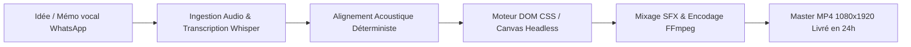
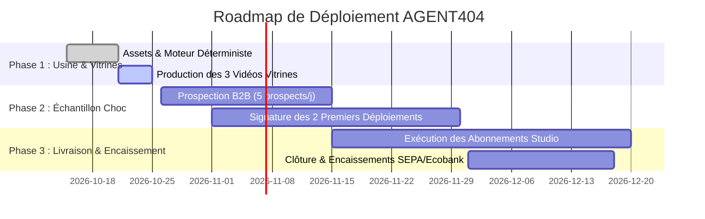

# PRODUCT REQUIREMENTS DOCUMENT (PRD)
# AGENT404 // Moteur de Vidéo Programmatique & Studio B2B

---

## 1. Document Control & Executive Summary

| Propriété | Détail |
| :--- | :--- |
| **Produit** | **AGENT404 Programmatic Video Engine** |
| **Document** | Product Requirements Document (PRD) |
| **Version** | `1.0.0` |
| **Statut** | **Actif / En Production** |
| **Propriétaire** | Kreesten AGBOTON // AGENT404 |
| **Dernière mise à jour** | 17 Octobre 2026 |
| **Stack Technique** | Python 3.12, FFmpeg, Playwright/Chromium Headless, HTML5/CSS3/ES6+ |

### Vision Produit
AGENT404 est un **moteur de rendu vidéo programmatique et déterministe** conçu pour éliminer 100 % de la friction de création de contenu court (format vertical 9:16, 1080 × 1920 @ 30 FPS).  
Il transforme une simple note vocale (audio brut) en une vidéo animée de qualité studio, rythmée par un avatar expressif, des sous-titres karaoké millimétrés, des bruitages broadcast et des composants graphiques dynamiques, **sans caméra, sans monteur humain et sans les artefacts visuels des IA génératives (Veo, Kling, Sora)**.

---

## 2. Problématique & Opportunité de Marché

### 2.1 Les Douleurs du Marché (Pain Points)
- **Monteurs vidéo traditionnels** : Coûteux (50 € à 150 € par vidéo courte), lents (délais de 48h à 72h par itération), disponibilité aléatoire et communication chronophage.
- **Outils d'IA générative vidéo (Kling, Veo, Runway)** : Imprévisibles, visages et mains déformés, texte illisible à l'écran, hallucinations visuelles impossibles à corriger chirurgicalement, abonnements onéreux.
- **Fondateurs SaaS, consultants & dirigeants d'agences B2B** : Conscients que le format court vertical est le canal d'acquisition organique n°1, mais bloqués par le syndrome de la caméra, le manque de temps pour tourner et la complexité des logiciels de montage (Premiere Pro, DaVinci).

### 2.2 La Solution AGENT404
- **Zéro tournage caméra** : Le client envoie une note vocale (ex. mémo WhatsApp de 1 à 2 minutes).
- **Rendu 100% piloté par le code** : Génération automatisée via un pipeline déterministe en Python et JavaScript.
- **Délais de livraison ultra-courts** : Vidéo prête en moins de 24 heures (temps de compilation machine : ~2 minutes pour 60 secondes).
- **Coût marginal de production nul** : 0 € de coût d'API vidéo par génération.

---

## 3. Personas Cibles & Parcours Utilisateur

### 3.1 Cibles Prioritaires
1. **Fondateurs de SaaS B2B** : Besoin d'expliquer leur logiciel, leurs cas d'usage et leurs fonctionnalités sans tourner en continu.
2. **Dirigeants d'agences & Consultants B2B** : Experts publiant déjà des posts texte ou des podcasts sur LinkedIn/YouTube, mais dont les vidéos courtes sont absentes ou peu captivantes.
3. **Créateurs de contenu tech / business** : Producteurs de contenu cherchant la régularité absolue sans fatigue de tournage.

### 3.2 Parcours Utilisateur (Client Journey)


---

## 4. Spécifications Fonctionnelles & Architecture du Moteur

### 4.1 Module 1 : Ingestion Audio & Alignement Forcé (`build_master_timeline.py`)
- **Sources audio supportées** :
  - `reference` : Fichier master voix off ElevenLabs ou studio (aucun découpage de silence destructeur).
  - `recording` : Enregistrement brut téléphone/micro avec analyse RMS 10 ms et coupe chirurgicale des silences longs (> 0,14 s) sans mordre sur la voix.
- **Transcription acoustique** : Extraction mot-à-mot via `faster-whisper` (`small`, `cpu_threads=2`, `word_timestamps=True`).
- **Alignement forcé sans glissement** :
  - Normalisation NFD (suppression d'accents) pour une comparaison robuste.
  - Gestion des contractions (`l'ai`, `j'ai`, `c'est`, `j'enregistre`, `envoie-moi`).
  - Découpage acoustique des devises combinées (`0€.` ventilé sur `0` et `euro.`).
  - Tolérance zéro : arrêt immédiat avec levée d'erreur si un mot de référence diverge (interdiction formelle d'inventer des timestamps).
- **Contrôles de validation automatique** :
  - Validation stricte de la chronologie (`start < end` pour chaque mot).
  - Bornage temporel `[0.0, durée_audio]`.
  - Continuité parfaite des 35 scènes (`scène[i].start == scène[i-1].end`).

### 4.2 Module 2 : Timeline & Logique Visuelle Déterministe (`timeline.js` / `video.js`)
- **Structure temporelle** : 35 scènes coordonnées, chacune débutant à la milliseconde précise où le premier mot de son sujet est prononcé.
- **Sous-titres dynamiques (Karaoké Neo-Brutaliste)** :
  - Conteneur unique avec bordure noire `3px` et fond blanc contrasté.
  - Découpage par paquets réguliers de 4 mots.
  - Surbrillance du mot actif au vert `#00F5A0` avec police grasse et agrandissement instantané.
- **Catalogue des 35 composants visuels** :
  - `face` : Avatar expressif (12 poses détourées) avec badge biseauté et flottement continu.
  - `big` : Typographie géante percutante (mots-clés, chiffres chocs) avec animation spring overshoot.
  - `cards` : Cartes comparatives biseautées avec icônes et sous-titres contextuels (ex. Premiere Pro, Veo/Kling, fondateurs SaaS).
  - `engine_arch` : Schéma d'architecture technique (Python 3.12 🐍 ↔ JavaScript DOM ⚡).
  - `audio_wave` : Visualiseur de spectre audio animé simulant la suppression des silences.
  - `sync_timer` : Compteur digital de précision milliseconde.
  - `emotion_morph` : Métamorphose de l'avatar selon l'état émotionnel du discours.
  - `window` : Terminal de commande hacker/cyber avec effet machine à écrire (*typewriter*).
  - `list` : Listes ordonnées avec numérotation biseautée et animation d'apparition progressive.
  - `split` : Tableau comparatif double colonne (« Avant ❌ » vs « Après ✅ »).
  - `speed_counter` : Jauge de vitesse comparative (Code Python 2 min vs Monteur 3h).
  - `ffmpeg_render` : Barre de progression de compilation temps réel.
- **Décors de fond dynamiques** :
  - Fond immuable sombre `#0D1117`.
  - Grille technique (`bg-grid`), losanges cyber-mint (`bg-diamonds`) et cercles cinétiques (`bg-circles`).

### 4.3 Module 3 : Sound Design Automatisé (`sfx.py`)
- Mixage binaural non destructif calé sur les temps de début de chaque scène :
  - **Pop organique mat** (35 ms, glissement 90 Hz ➔ 40 Hz, -22 dB) sur les apparitions visuelles.
  - **Whoosh feutré** (40 ms, bruit rose filtré passe-bas 1200 Hz, -24 dB) sur les transitions de chapitre.
  - **Micro-clics mécaniques** (8 ms, impulsion amortie 650 Hz, -26 dB) sur le terminal typewriter.
- Génération du master audio mixé : `audio_final.wav`.

### 4.4 Module 4 : Rendu Vidéo Déterministe (`render.py`)
- Pilotage frame-par-frame via Playwright (`executable_path='/usr/bin/google-chrome'`).
- Rendu déterministe via l'injection `window.setTime(t)` à chaque frame `i / 30.0`.
- Évacuation mémoire périodique (recyclage du contexte de page toutes les 150 frames) pour éviter les fuites RAM/V8.
- Pipeline FFmpeg `image2pipe` direct vers encodeur H.264 (profil High, `crf=18`, `preset=veryfast`, audio AAC 192 kbps).
- Calcul du nombre de frames par `math.ceil(duration * fps)` pour garantir qu'aucune milliseconde d'audio final ne soit coupée.

---

## 5. Exigences Non-Fonctionnelles & Standards Techniques

| Exigence | Standard / Métrique cible |
| :--- | :--- |
| **Résolution d'export** | 1080 × 1920 pixels (format vertical 9:16) |
| **Cadence d'images (FPS)** | 30.000 FPS fixe (zéro frame drop) |
| **Déterminisme** | 100 % reproductible : chaque instant `t` produit la même image au pixel près |
| **Performance de rendu** | < 6 minutes pour une vidéo de 60 secondes sur CPU standard |
| **Qualité audio** | PCM 44,1 kHz / Export AAC 192 kbps, son clair et sans écrêtage |
| **Poids du master MP4** | 12 à 15 Mo par minute (optimisé pour upload immédiat sans recompression) |

---

## 6. Feuille de Route & Phases de Déploiement Commercial



### Phase 1 · Construire l'usine avec Antigravity (15 Octobre – 25 Octobre)
1. **Génération des assets clés** : 12 poses d'avatar détourées en PNG (contour blanc et bordure noire nette).
2. **Finalisation du moteur vidéo** : Pipeline Python + JS + FFmpeg validé sans dérive temporelle.
3. **Production des 3 premières vidéos vitrines** :
   - *Vitrine 1* : La fabrication de vidéos animées 100% par du code.
   - *Vitrine 2* : Les coûts cachés et failles de sécurité des outils IA classiques.
   - *Vitrine 3* : Le lancement d'un produit tech en 60 secondes chrono.
4. **Diffusion multi-plateforme** : Publication sur TikTok, Instagram et LinkedIn (cœur de cible B2B).

### Phase 2 · La Technique de « L'Échantillon Choc » (26 Octobre – 30 Novembre)
*Objectif : Encaisser les premiers virements sans dépendre d'une audience préexistante.*
1. **Ciblage quotidien** : Identifier chaque jour 5 créateurs B2B, dirigeants d'agences ou fondateurs SaaS (actifs sur LinkedIn ou YouTube, mais absents du format court vertical).
2. **Conception d'un échantillon personnalisé (15 secondes)** :
   - Extraire 15 secondes de leur propre voix (issue de leur podcast, interview ou vidéo YouTube).
   - Générer 3 poses d'un avatar à leur effigie.
   - Passer l'audio dans le moteur pour générer un extrait percutant en moins de 20 minutes.
3. **Message d'accroche direct en DM (LinkedIn / Email)** :
   > *« Bonjour [Prénom], j'ai écouté ton dernier passage audio. J'ai codé un moteur qui transforme ta voix en vidéo animée sur-mesure (regarde le rendu de 15 secondes ci-joint avec ton avatar).*  
   > *Zéro tournage caméra pour toi : tu m'envoies un vocal WhatsApp de 2 minutes, je te livre la vidéo montée et animée en 24h. On teste sur un pack de 8 vidéos ce mois-ci ? »*

### Phase 3 · Livraison, Récurrence et Encaissement (Novembre – 20 Décembre)
1. **Facturation immédiate & Acompte** :
   - Facturation directe avec coordonnées bancaires (IBAN Moneco pour virement SEPA 24-48h zone Euro, ou RIB Ecobank).
   - **50 % d'acompte obligatoire** avant le codage de l'univers graphique sur-mesure.
2. **Double levier commercial (Upsell Développement Web/IA)** :
   - Si un prospect valide la prouesse technique mais recherche une infrastructure logicielle, bascule vers l'offre de développement web, landing page ou MVP d'agent IA.
3. **Date limite d'encaissement** :
   - Clôturer et faire signer les contrats avant le **18 décembre** pour garantir l'arrivée des virements SEPA avant les congés bancaires annuels.

---

## 7. Grille des Offres Commerciales & Modèle Économique

Les offres détaillées sont consignées dans [OFFRES.md](file:///home/hasashi/Bureau/video/OFFRES.md).

```text
├── OFFRE 1 : Short-Form Studio (Abonnement mensuel)
│   ├── Tarif : 500 € / mois (≈ 328 000 FCFA)
│   ├── Volume : 8 vidéos verticales / mois
│   └── Format : Done-For-You (délai 24h par lot)
│
├── OFFRE 2 : Engine Deployment (Installation clé en main)
│   ├── Tarif de lancement : 750 € (≈ 492 000 FCFA) pour les 2 premiers clients
│   ├── Tarif standard : 1 500 € (après industrialisation et validation de cas client)
│   └── Tarif avancé : 2 000 € (intégrations spécifiques et infrastructure avancée)
│
└── PHASE POST-VALIDATION : Formations en Ligne
    ├── Formation 1 : Créer des vidéos animées avec l'IA (19 € à 49 €)
    ├── Formation 2 : Automatiser sa production vidéo (79 € à 199 €)
    └── Formation 3 : IA appliquée aux projets réels (sur devis)
```

---

## 8. Indicateurs Clés de Succès (KPIs)

- **Conversion Prospection** : Taux de réponse à l'Échantillon Choc ≥ **15 %**.
- **Signature Déploiement** : 2 premiers déploiements validés à 750 € avant le 30 Novembre.
- **Récurrence Studio** : 3 à 5 clients actifs en abonnement (MRR cible : 1 500 € à 2 500 € / mois).
- **SLA de Livraison** : 100 % des vidéos livrées sous 24h ouvrées après réception du mémo vocal.
- **Fiabilité Technique** : Taux d'échec de rendu = **0 %**, dérive audio/visuelle = **0 ms**.

---

## 9. Gestion des Risques & Mesures d'Atténuation

| Risque identifié | Niveau | Impact | Mesure d'atténuation |
| :--- | :---: | :---: | :--- |
| **Désynchronisation audio/sous-titres** | Élevé | Critique | Validation automatique obligatoire via `validate_timeline()` avant chaque rendu. Arrêt immédiat si un mot diverge. |
| **Saturation mémoire Chromium (OOM)** | Moyen | Élevé | Recyclage périodique du contexte Playwright toutes les 150 frames dans `render.py`. |
| **Client incapable d'exploiter le moteur (Offre 2)** | Élevé | Modéré | Cadrage contractuel strict des prérequis techniques, session de formation en direct et fourniture d'une documentation étape par étape. |
| **Délais bancaires de fin d'année** | Moyen | Financier | Date butoir de facturation fixée au 18 décembre pour les virements SEPA. |