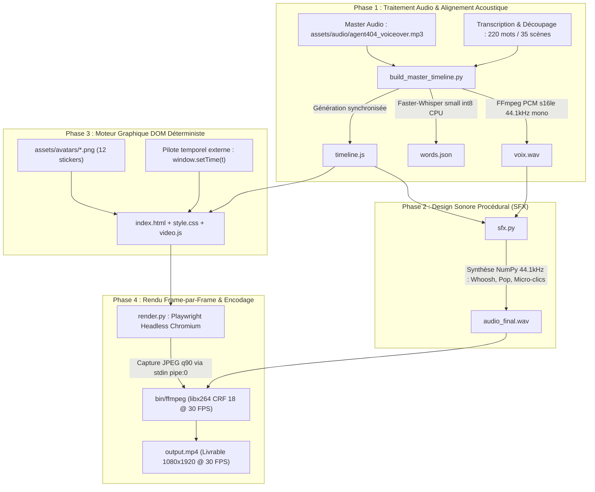

# AGENT404 // SPÉCIFICATIONS TECHNIQUES DE L'ARCHITECTURE DU MOTEUR

> **Statut de gouvernance** : DOCUMENTATION TECHNIQUE DE RÉFÉRENCE  
> **Dernière mise à jour** : 17 octobre 2026  
> **Type de système** : Moteur vidéo programmatique déterministe (1080×1920 @ 30 FPS, vertical 9:16)  

---

## 1. VUE D'ENSEMBLE DU PIPELINE DE PRODUCTION

Le moteur AGENT404 convertit une piste audio vocale et un texte en un fichier MP4 finalisé sans recours à un logiciel de montage conventionnel (Premiere Pro, DaVinci) ni à un framework vidéo lourd (Remotion, React, Node.js).  
Le pipeline repose sur un découpage en 4 phases strictement séquentielles :



---

## 2. DÉTAIL DES MODULES LOGICIELS ET SCRIPTS

### A. Ingestion et Alignement Forcé : [build_master_timeline.py](file:///home/hasashi/Bureau/video/build_master_timeline.py)
- **Rôle** : Convertit l'audio brut en PCM standardisé, force l'alignement acoustique mot-à-mot via Whisper, découpe la narration en scènes continues et génère [timeline.js](file:///home/hasashi/Bureau/video/timeline.js).
- **Fonctionnement interne** :
  1. *Conversion audio* : Appelle FFmpeg pour convertir le MP3 source en `voix.wav` (PCM 16-bit mono à 44 100 Hz).
  2. *Inférence Whisper* : Exécute `faster-whisper` (modèle `small`, CPU, calcul quantifié `int8`, 2 threads) pour obtenir les timestamps bruts de chaque token audio.
  3. *Alignement forcé sans interpolation* : Mappe les tokens bruts sur la liste `REFERENCE_WORDS` (220 mots) via normalisation NFD (suppression d'accents) et dictionnaire de variantes phonétiques (`saas` ➔ `sass`, `prix` ➔ `pris`, `0€.` ➔ `0` + `euro.`).
  4. *Découpage des 35 scènes* : Recherche les timestamps exacts des `scene_end_words` et assigne les intervalles $[start, end]$ de chaque scène.
  5. *Validation automatique bloquante* :
     - Vérifie que chaque mot respecte $start < end$.
     - Vérifie qu'aucun mot n'est inventé ou omis.
     - Vérifie que chaque scène s'enchaîne sans trou ni chevauchement ($\Delta t \le 0{,}001\text{ s}$).
     - Vérifie la cohérence entre durée calculée et durée du fichier audio.

### B. Sound Design Procédural : [sfx.py](file:///home/hasashi/Bureau/video/sfx.py)
- **Rôle** : Génère par synthèse mathématique pure (NumPy) des micro-bruitages feutrés calés sur le rythme des scènes, sans nécessiter de banques d'échantillons payantes.
- **Micro-bruitages synthétisés** :
  1. *Whoosh feutré (40 ms)* : Bruit blanc/rose filtré par moyenne mobile (passe-bas ~1200 Hz) avec enveloppe en cloche de Hann. Utilisé sur les transitions majeures et changements de décor. Atténuation : $-24\text{ dB}$.
  2. *Pop organique mat (35 ms)* : Glissement sinusoïdal grave (90 Hz vers 40 Hz) avec enveloppe amortie. Utilisé sur les apparitions de cartes, d'avatars et d'écrans scindés. Atténuation : $-22\text{ dB}$.
  3. *Micro-clics typewriter (8 ms)* : Impulsions amorties à 650 Hz injectées toutes les 120 ms pendant l'animation de la fenêtre terminal. Atténuation : $-26\text{ dB}$.
- **Mixage** : Superpose les formes d'ondes au signal vocal, applique un clamp strict $[-32767, 32767]$ pour éviter tout écrêtage, et exporte [audio_final.wav](file:///home/hasashi/Bureau/video/audio_final.wav).

### C. Moteur Graphique et Composants Visuels : [video.js](file:///home/hasashi/Bureau/video/video.js)
- **Rôle** : Interface de rendu DOM fonctionnant sans horloge asynchrone (`Date.now()`, `requestAnimationFrame` ou `setInterval` proscrits).
- **Point d'entrée déterministe** : Fonction globale `window.setTime(t)` où $t$ est le temps absolu en secondes.
- **Composants implémentés** :
  1. `face` : Avatar sticker animé avec physique d'overshoot au démarrage, flottement sinusoïdal vertical continu ($\sin(5t) \times 10\text{px}$), inclinaison ($\sin(2.5t) \times 1.5^\circ$) et badge textuel à $-2^\circ$.
  2. `big` : Typographie d'impact grand format (56px ou 68px) avec sous-titre et animation de rebond élastique.
  3. `cards` : 1 ou 2 cartes néo-brutalistes avec icône, titre et sous-titre, apparaissant en cascade cadencée (stagger delay de $0{,}15\text{ s}$).
  4. `list` : Liste ordonnée néo-brutaliste avec numérotation 01, 02... et surbrillance progressive synchronisée sur le temps de scène.
  5. `window` : Fenêtre terminal style OS avec barre de titre et frappe au clavier progressive caractère par caractère (`typewriter`) avec curseur clignotant.
  6. `split` : Écran scindé comparatif (Mauvaise pratique en rouge vs Bonne pratique en vert menthe).
  7. `engine_arch` : Schéma d'architecture dynamique avec engrenage en rotation continue ($120^\circ/s$).
  8. `sync_timer` : Compteur de millisecondes dynamique avec verrouillage successif de pilules temporelles.
  9. `emotion_morph` : Changement d'expression de l'avatar en cours de scène (Enthousiaste ➔ Choqué ➔ Sceptique).
  10. `ffmpeg_render` : Simulation de progression de compilation avec barre de pourcentage et compteur de frames.
  11. `speed_counter` : Comparateur de performance graphique avec double barre de chargement.
  12. `audio_wave` : Oscilloscope de 28 barres avec simulation d'extinction de silences à $t \ge 0{,}42 \times \text{durée}$.
  13. `rpg` : Boîte de dialogue de jeu de rôle (implémentée dans le code, non sollicitée dans la vidéo n° 1).

### D. Capture Headless et Compilation Vidéo : [render.py](file:///home/hasashi/Bureau/video/render.py)
- **Rôle** : Orchestre Playwright Headless pour capturer chaque frame à 30 FPS et les injecter directement dans le pipe d'entrée de FFmpeg.
- **Sécurisation mémoire anti-OOM (Out-Of-Memory)** :
  - Sur des machines à ressources limitées (ex: 8 Go RAM), Chromium accumule des buffers GPU/Skia.
  - `render.py` applique un recyclage automatique du contexte de page toutes les 150 frames (`page.close()`, `context.close()`, `gc.collect()`), garantissant une empreinte RAM stable sous 1 Go.
- **Commande FFmpeg exécutée** :
  ```bash
  ffmpeg -y -f image2pipe -vcodec mjpeg -r 30 -i pipe:0 \
         -i audio_final.wav -c:v libx264 -pix_fmt yuv420p \
         -preset veryfast -threads 2 -crf 18 -c:a aac -b:a 192k -shortest output.mp4
  ```

### E. Traitement Graphique des Avatars : [build_stickers.py](file:///home/hasashi/Bureau/video/build_stickers.py)
- **Rôle** : Prend les photos brutes [raw_avatars/*.jpg](file:///home/hasashi/Bureau/video/raw_avatars) sur fond uni, élimine le fond par flood-fill et morphologie mathématique (protection de la chemise blanche et de la peau), recentre le sujet en $900 \times 1050$ ancré au bord bas, et applique une double bordure sticker néo-brutaliste (bordure blanche épaisse + filet noir externe).

---

## 3. DÉPENDANCES ET ENVIRONNEMENT TECHNIQUE

### A. Dépendances Python réelles
- `faster-whisper >= 1.0.0` (Inférence acoustique via CTranslate2)
- `playwright >= 1.40.0` (Automatisation de Chromium headless)
- `numpy >= 1.26.0` (Synthèse sonore procédurale et traitement matriciel d'image)
- `Pillow >= 10.0.0` (Détourage et application des bordures stickers)

### B. Binaires et composants système
- **FFmpeg & FFprobe** : Actuellement fournis sous forme d'exécutables statiques Linux x86_64 dans le dossier [bin/](file:///home/hasashi/Bureau/video/bin/).
- **Navigateur Chromium** : Piloté via Playwright (ou Google Chrome système si disponible).
- **Polices typographiques** : Montserrat, Plus Jakarta Sans, Syne, JetBrains Mono (chargées dynamiquement depuis Google Fonts via `<link>` dans [index.html](file:///home/hasashi/Bureau/video/index.html)).

---

## 4. LIMITES D'ARCHITECTURE, RIGIDITÉS ET PORTABILITÉ

L'audit technique a mis en évidence 4 rigidités majeures qui séparent le prototype actuel d'un moteur industriel :

```
┌───────────────────────────────────────┬──────────────────────────────────────────┐
│ RIGIDITÉ OBSERVÉE DANS LE CODE        │ IMPACT TECHNIQUE ET OPÉRATIONNEL         │
├───────────────────────────────────────┼──────────────────────────────────────────┤
│ 1. Mots et scènes codés en dur dans   │ Impossible de générer une vidéo avec un  │
│    Python (220 mots, 35 scènes)       │ autre texte sans modifier le code source.│
├───────────────────────────────────────┼──────────────────────────────────────────┤
│ 2. Binaires bin/ compilés Linux x86_64│ Le moteur crashe immédiatement sur       │
│    (188 Mo chacun)                    │ macOS (Apple Silicon ARM) ou Windows.    │
├───────────────────────────────────────┼──────────────────────────────────────────┤
│ 3. Dépendance réseau Google Fonts     │ En l'absence de connexion Internet,      │
│    dans index.html                    │ le rendu Playwright bascule sur des      │
│    polices système, décalant le texte.│                                          │
├───────────────────────────────────────┼──────────────────────────────────────────┤
│ 4. Paramètres de marque en dur dans   │ Modifier les couleurs ou le nom du HUD   │
│    CSS et JavaScript                  │ exige d'éditer manuellement style.css.   │
└───────────────────────────────────────┴──────────────────────────────────────────┘
```

---

## 5. CAPACITÉS EXISTANTES VS FONCTIONNALITÉS ABSENTES

| Capacité technique | Statut réel | Commentaire d'ingénierie |
| :--- | :---: | :--- |
| Rendu déterministe frame-par-frame | **OUI** | Parfaitement fonctionnel via `window.setTime(t)`. |
| Synchronisation sous-titres mot-à-mot | **OUI** | Calée sur Whisper au millième de seconde. |
| Sound design procédural sans banque audio | **OUI** | Généré en pur calcul NumPy sans fichier externe. |
| Encodage MP4 optimisé 1080×1920 @ 30 FPS | **OUI** | Flux H.264 High Profile fluide et propre. |
| Suite de tests de non-régression Golden Master | **OUI** | 6 tests unitaires passants sur la branche dédiée. |
| Pilotage par fichier de configuration `project.json` | **NON** | Données de scène actuellement écrites dans le script Python. |
| Personnalisation par charte de marque `brand.json` | **NON** | Couleurs et logos codés en dur dans HTML/CSS. |
| CLI universel d'orchestration `run.py` | **NON** | Nécessite de lancer 3 scripts Python manuellement. |
| Exécution autonome sur macOS et Windows | **NON** | Bloqué par les binaires ELF statiques Linux dans `bin/`. |
| Polices de caractères embarquées localement | **NON** | Dépendance externe active vers le CDN Google Fonts. |
