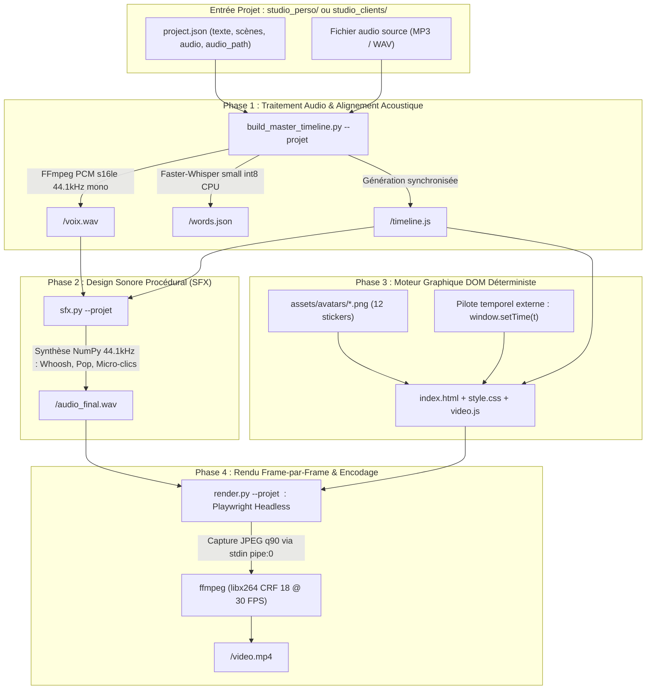

# AGENT404 : SPÉCIFICATIONS TECHNIQUES DE L'ARCHITECTURE DU MOTEUR

Statut de gouvernance : DOCUMENTATION TECHNIQUE DE RÉFÉRENCE  
Dernière mise à jour : 19 octobre 2026  
Type de système : Moteur vidéo programmatique déterministe (1080x1920 @ 30 FPS, vertical 9:16)  
Positionnement stratégique : Clarté visuelle B2B programmatique qui remplace la caméra et fait signer des clients. Ne pas vendre « du code Python », mais un pipeline de transformation transformant des Looms inefficaces ou des notes vocales en vidéos de 45-60s percutantes pour SaaS B2B (70%) et agences tech (30%).

---

## 1. LES 5 CONCEPTS DIRECTEURS DE L'ARCHITECTURE

L'ensemble de l'architecture logicielle est rigoureusement aligné sur 5 concepts immuables :

1. **Concept 1 : Définir le problème précis plutôt qu'une idée vague**  
   *« Tu ne décris plus une idée. Tu définis le problème à résoudre. »*  
   - L'architecture résout un problème précis : l'abandon précoce des prospects B2B face à des démos d'écran partagé trop longues (Looms de 10 min). Chaque module logiciel vise la clarté immédiate et la densification du message en moins de 60 secondes.
2. **Concept 2 : Décrire les gestes et le fonctionnement étape par étape**  
   *« Tu passes d'un concept à un fonctionnement que tu peux vérifier, étape par étape. »*  
   - Zéro effet boîte noire : le pipeline est décomposé en 4 étapes modulaires, traçables et vérifiables individuellement :
     - Étape 1 : Conversion PCM et alignement acoustique forcé mot-à-mot via Whisper (`build_master_timeline.py`).
     - Étape 2 : Synthèse mathématique de sound design procédural sans banque d'échantillons (`sfx.py`).
     - Étape 3 : Pilotage temporel analytique déterministe du DOM sans horloge asynchrone (`video.js`).
     - Étape 4 : Rendu image-par-image sous Chromium Headless et encodage FFmpeg (`render.py`).
3. **Concept 3 : Définir explicitement ce qu'on refuse (Les non-objectifs)**  
   *« Dis aussi ce que tu ne veux pas. La clarté, c'est aussi décider ce qui peut attendre. »*  
   - **Refus des frameworks lourds** : Aucun runtime React, Node.js, Next.js ou Remotion dans le moteur de rendu.
   - **Refus du non-déterminisme** : Proscription de toute animation CSS temps réel ou interpolation asynchrone (`Date.now()`, `requestAnimationFrame`).
   - **Refus du HUD** : Suppression définitive et irrévocable de tout bandeau HUD (`#agent-hud`) dans le DOM.
   - **Refus du jargon technique et des prix dans les vidéos** : Aucun terme technique ou chiffre tarifaire n'apparaît dans les sous-titres ou éléments visuels publics.
4. **Concept 4 : Remplacer « ça ne marche pas » par un constat précis mesuré**  
   *« Identifie l'écart entre le résultat attendu et le résultat obtenu. »*  
   - Les écarts sont systématiquement quantifiés par des sondes techniques :
     - Écart d'alignement audio mesuré en millisecondes ($\Delta t \le 0{,}001\text{ s}$).
     - Reproductibilité validée par framemd5 et PSNR infini.
     - Contrôle de présence d'avatar par analyse d'histogramme de luminance OpenCV (> 32 sur zone sticker).
     - Vérification de conformité de flux par `ffprobe` (1080x1920, 30.0 fps, yuv420p, aac).
5. **Concept 5 : Des décisions claires avec critères d'acceptation testables**  
   *« Je saurai que ça fonctionne si... Un brief précis ne garantit pas un code fiable : il faut encore le tester. »*  
   - Aucun commit ni rendu n'est considéré valide sans le passage à 100 % de la suite de tests automatisés (`pytest tests/`). Les critères d'acceptation couvrent l'intégrité temporelle, la continuité des scènes et l'intégrité bit-à-bit.

---

## 2. VUE D'ENSEMBLE DU PIPELINE DE PRODUCTION

Le moteur AGENT404 convertit une piste audio vocale et un texte en un fichier MP4 finalisé sans recours à un logiciel de montage conventionnel (Premiere Pro, DaVinci) ni à un framework vidéo lourd (Remotion, React, Node.js).  
Le pipeline repose sur un découpage en 4 phases strictement séquentielles :

---

## 3. DÉTAIL DES MODULES LOGICIELS ET SCRIPTS

### A. Ingestion et Alignement Forcé : [build_master_timeline.py](../build_master_timeline.py)
- **Rôle** : Convertit l'audio brut en PCM standardisé, force l'alignement acoustique mot-à-mot via Whisper, découpe la narration en scènes continues et génère [timeline.js](../timeline.js).
- **Fonctionnement interne** :
  1. *Conversion audio* : Appelle FFmpeg pour convertir le MP3 source en `voix.wav` (PCM 16-bit mono à 44 100 Hz).
  2. *Inférence Whisper* : Exécute `faster-whisper` (modèle `small`, CPU, calcul quantifié `int8`, 2 threads) pour extraire les timestamps bruts de chaque token audio.
  3. *Alignement forcé sans interpolation* : Mappe les tokens bruts sur la liste `REFERENCE_WORDS` (220 mots) via normalisation NFD (suppression d'accents) et dictionnaire de variantes phonétiques.
  4. *Découpage des 35 scènes* : Recherche les timestamps exacts des `scene_end_words` et assigne les intervalles $[start, end]$ de chaque scène.
  5. *Validation automatique bloquante* :
     - Vérifie que chaque mot respecte $start < end$.
     - Vérifie qu'aucun mot n'est inventé ou omis.
     - Vérifie que chaque scène s'enchaîne sans trou ni chevauchement ($\Delta t \le 0{,}001\text{ s}$).
     - Vérifie la cohérence entre durée calculée et durée du fichier audio.

### B. Sound Design Procédural : [sfx.py](../sfx.py)
- **Rôle** : Génère par synthèse mathématique pure (NumPy) des micro-bruitages feutrés calés sur le rythme des scènes, sans nécessiter de banques d'échantillons externes.
- **Micro-bruitages synthétisés** :
  1. *Whoosh feutré (40 ms)* : Bruit filtré passe-bas avec enveloppe en cloche de Hann sur les transitions majeures. Atténuation : $-24\text{ dB}$.
  2. *Pop organique mat (35 ms)* : Glissement sinusoïdal grave (90 Hz vers 40 Hz) avec enveloppe amortie pour les apparitions de cartes et d'avatars. Atténuation : $-22\text{ dB}$.
  3. *Micro-clics typewriter (8 ms)* : Impulsions amorties à 650 Hz injectées toutes les 120 ms pendant l'animation de la fenêtre terminal. Atténuation : $-26\text{ dB}$.
- **Reproductibilité déterministe** : Lorsque `rendu_deterministe: true` (par défaut), une graine stable dérivée de l'identifiant du projet (`zlib.crc32`) alimente un générateur `np.random.default_rng(seed)`. Deux mixages successifs produisent des fichiers WAV identiques octet par octet (SHA-256 rigoureusement identiques). Si `rendu_deterministe: false` (cas de `video_01`), le comportement historique sans graine est préservé.
- **Mixage** : Superpose les formes d'ondes au signal vocal, applique un clamp strict $[-32767, 32767]$ pour éviter tout écrêtage, et exporte [audio_final.wav](../audio_final.wav).

### C. Moteur Graphique et Composants Visuels : [video.js](../video.js)
- **Rôle** : Interface de rendu DOM fonctionnant sans horloge asynchrone (`Date.now()`, `requestAnimationFrame` ou `setInterval` proscrits).
- **Point d'entrée déterministe** : Fonction globale `window.setTime(t)` où $t$ est le temps absolu en secondes.
- **Composants implémentés** :
  1. `face` : Avatar sticker animé avec physique d'overshoot au démarrage, flottement sinusoïdal vertical continu ($\sin(5t) \times 10\text{px}$), inclinaison ($\sin(2.5t) \times 1.5^\circ$) et badge textuel à $-2^\circ$.
  2. `big` : Typographie d'impact grand format (56px ou 68px) avec sous-titre et animation de rebond élastique.
  3. `cards` : 1 ou 2 cartes néo-brutalistes avec icône, titre et sous-titre, apparaissant en cascade cadencée (stagger delay de $0{,}15\text{ s}$).
  4. `list` : Liste ordonnée néo-brutaliste avec numérotation 01, 02... et surbrillance progressive synchronisée sur le temps de scène.
  5. `window` : Fenêtre terminal style OS avec barre de titre et frappe au clavier progressive caractère par caractère (`typewriter`) avec curseur clignotant.
  6. `split` : Écran scindé comparatif (Mauvaise pratique en rouge vs Bonne pratique en vert menthe).
  7. `engine_arch` : Schéma d'architecture dynamique avec engrenage en rotation continue ($120^\circ/s$).
  8. `sync_timer` : Compteur de millisecondes dynamique avec verrouillage successif de pilules temporelles.
  9. `emotion_morph` : Changement d'expression de l'avatar en cours de scène (Enthousiaste -> Choqué -> Sceptique).
  10. `ffmpeg_render` : Simulation de progression de compilation avec barre de pourcentage et compteur de frames.
  11. `speed_counter` : Comparateur de performance graphique avec double barre de chargement.
  12. `audio_wave` : Oscilloscope de 28 barres avec simulation d'extinction de silences.
  13. `rpg` : Boîte de dialogue de jeu de rôle.

### D. Capture Headless et Compilation Vidéo : [render.py](../render.py)
- **Rôle** : Orchestre Playwright Headless pour capturer chaque frame à 30 FPS et les injecter directement dans le pipe d'entrée de FFmpeg.
- **Rendu déterministe bit-à-bit** :
  - Lorsque `rendu_deterministe: true` (par défaut), injecte une feuille de style désactivant toutes les transitions et animations CSS (`*, *::before, *::after { transition: none !important; animation: none !important; }`), éliminant l'interpolation en temps réel pendant les captures Playwright. Deux rendus successifs produisent des frames décodées 100% identiques (framemd5 identiques, PSNR infini).
- **Synchronisation totale des images et polices** :
  - Attente de `document.fonts.ready` et exécution de `img.decode()` sur toutes les images avant chaque capture pour éradiquer les images d'avatar vides.
  - Pré-décodage complet de tous les avatars à l'initialisation et à chaque recyclage.
- **Sécurisation mémoire anti-OOM** :
  - Recyclage automatique du contexte de page toutes les 150 frames (`page.close()`, `context.close()`, `gc.collect()`), garantissant une empreinte RAM stable sous 1 Go.
- **Vérification automatique post-rendu** :
  - Analyse d'image automatisée contrôlant que chaque scène avec avatar contient bien son avatar (zone non vide).

### E. Traitement Graphique des Avatars : [build_stickers.py](../build_stickers.py)
- **Rôle** : Prend les photos brutes [raw_avatars/*.jpg](../raw_avatars) sur fond uni, élimine le fond par flood-fill et morphologie mathématique, recentre le sujet en $900 \times 1050$ ancré au bord bas, et applique une double bordure sticker néo-brutaliste (bordure blanche épaisse + filet noir externe).

---

## 4. DÉPENDANCES ET ENVIRONNEMENT TECHNIQUE

### A. Dépendances Python réelles
- `faster-whisper >= 1.0.0` (Inférence acoustique via CTranslate2)
- `playwright >= 1.40.0` (Automatisation de Chromium headless)
- `numpy >= 1.24.0` (Synthèse sonore procédurale et traitement matriciel d'image)
- `Pillow >= 10.0.0` (Détourage et application des bordures stickers)
- `scipy >= 1.10.0` (Morphologie mathématique dans build_stickers)

### B. Binaires et composants système
- **FFmpeg & FFprobe** : Détectés dynamiquement via la variable d'environnement PATH et `shutil.which`.
- **Navigateur Chromium** : Piloté via Playwright (ou Google Chrome système si disponible).
- **Polices typographiques** : Montserrat, Plus Jakarta Sans, Syne, JetBrains Mono embarquées localement dans `assets/fonts/` (licence OFL, 100% hors ligne).

---

## 5. ARCHITECTURE MULTI-PROJETS (STUDIO PERSO & CLIENTS)

La séparation des studios est effective et élimine tout contenu en dur dans le moteur :
- **Studio Perso (`studio_perso/`)** : Dédié aux vidéos propres d'AGENT404 (vitrine, démonstrations, acquisition client).
- **Studio Clients (`studio_clients/`)** : Dédié aux productions des clients, chaque client disposant de son dossier et de sa configuration propre.
- **Configuration unifiée (`project.json`)** : Chaque projet définit son numéro de vidéo, titre, audio, texte de référence, scènes, mots terminaux et variantes phonétiques.
- **Orchestrateur universel (`make_video.py`)** : Pilote de bout en bout la génération de timeline, le mixage SFX, le rendu déterministe, la vérification des avatars et le contrôle technique ffprobe.
