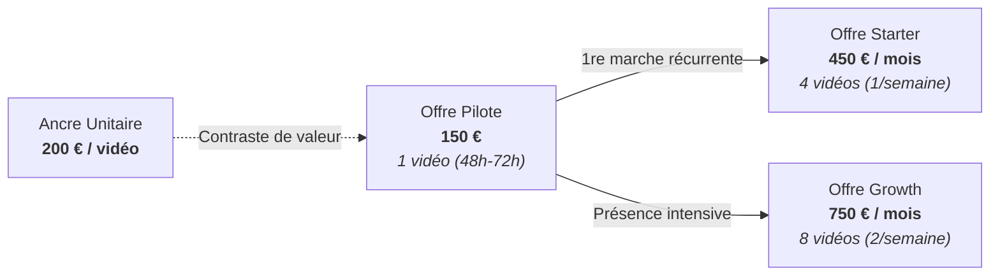

# AGENT404 : MODÈLE FINANCIER ET PLAN D'ENCAISSEMENT AU 31 DÉCEMBRE 2026

Statut de gouvernance : DOCUMENT FINANCIER MAÎTRE  
Date de référence : 28 octobre 2026 (Mise à jour stratégique : 30 octobre 2026)  
Propriétaire : Kreesten AGBOTON (Abomey-Calavi, Bénin)  
Taux de conversion officiel de référence : 1 EUR = 655,957 FCFA (parité fixe zone Franc CFA)  
Horizon d'exécution : 62 jours restants (du 30 octobre 2026 au 31 décembre 2026)  

---

## 1. Cadrage de l'Objectif Financier Directeur (North Star)

L'unique objectif financier du projet AGENT404 est d'encaisser du cash réel avant la fin de l'exercice 2026 en opérant le moteur comme un studio de production vidéo pour le personal branding des experts B2B sur LinkedIn.

| Indicateur | Valeur en FCFA | Valeur en Euros (€) | Statut méthodologique |
| :--- | :---: | :---: | :--- |
| **OBJECTIF MAÎTRE (North Star)** | **2 000 000 FCFA** | **≈ 3 049 €** | [OBJECTIF] Cible impérative au 31/12/2026 |
| **Plancher de repli réaliste** | **1 639 892 FCFA** | **2 500 €** | [OBJECTIF] Seuil de validation commerciale forte (82 %) |
| **Plancher de survie minimal** | **819 946 FCFA** | **1 250 €** | [OBJECTIF] Filet de sécurité en cas de friction sévère (41 %) |

Règle de gestion stricte : seul le cash effectivement crédité sur le compte bancaire est comptabilisé. Les promesses orales, intentions d'achat et factures émises non réglées valent 0 FCFA.

---

## 2. Situation Comptable Réelle

| Poste comptable | Montant constaté | Statut d'audit |
| :--- | :---: | :--- |
| **Encaissements réels à date** | **0 € / 0 FCFA** | [DÉCLARÉ PAR LE FONDATEUR - NON VÉRIFIÉ EN MACHINE] 0 € encaissés à ce jour |
| **Factures émises non encaissées** | **0 € / 0 FCFA** | [DÉCLARÉ PAR LE FONDATEUR - NON VÉRIFIÉ EN MACHINE] Aucune créance client en cours |
| **Montant restant à encaisser** | **2 000 000 FCFA** | [OBJECTIF] Soit environ 3 049 € à sécuriser d'ici le 31 décembre 2026 |

---

## 3. Structure des Coûts, Trésorerie & Quota Vocal

### A. Coûts variables de production
- **Génération vidéo locale (AGENT404)** : 0 € d'API vidéo par génération. Le pipeline tourne en local avec Playwright Chromium, Faster-Whisper et FFmpeg [FAIT VÉRIFIÉ].
- **Synthèse vocale (ElevenLabs)** :
  - **NOTE DE TRÉSORERIE CRITIQUE (Provision Quota Vocal)** :
    Dès l'encaissement du **premier Pilote (150 €)**, provisionner immédiatement **5 $ à 22 $ / mois** (environ 3 200 à 14 000 FCFA) pour faire passer le compte ElevenLabs du plan Gratuit (limité à ~10 000 caractères/mois, soit environ 10 vidéos courtes) au plan **Starter (5 $/m)** ou **Creator (22 $/m)** avec droits commerciaux.
  - Si le client fournit sa propre note vocale enregistrée proprement, le coût ElevenLabs est de 0 €.
- **Électricité et connectivité locale (Abomey-Calavi)** : Coût marginal estimé à 5 000 FCFA par mois de calcul machine [HYPOTHÈSE].

### B. Frais d'encaissement et commissions de paiement
- **Réception des fonds en devises (SEPA / International)** :
  - Option Moneco (compte avec IBAN européen) : Réception virement SEPA, conversion et rapatriement local.
  - Option Ecobank Bénin : Virement SWIFT direct ou intermédiaire de paiement (Stripe).
  - Règle opérationnelle : 100 % des règlements sont perçus d'avance avant livraison des fichiers masters MP4.

### C. Temps de travail humain (temps de production)
- Sélection de l'idée depuis le post LinkedIn ou la note vocale, structuration du script, paramétrage de la timeline (style Mascotte, Éditorial ou Démonstration) et validation acoustique.
- Temps estimé par vidéo : 45 min à 1h30 grâce à l'automatisation du moteur déterministe.

---

## 4. Architecture Tarifaire (Tarifs Expérimentaux sur 30 Jours)

Ces tarifs constituent des hypothèses commerciales qui devront être validées par les ventes et les coûts réels de production :

1. **Ancre Haute de référence (Hors abonnement)** : **200 € par vidéo** à l'unité.
2. **Offre Pilote (Test Découverte)** : **150 €** (environ **98 394 FCFA**).
   - Livrable : **1 vidéo** verticale (1080x1920 @ 30 FPS, 45s à 60s), livrée sous 48h à 72h ouvrées.
   - **Passerelle d'abonnement** : Les 150 € sont **100 % déduits** du premier mois d'abonnement (Starter ou Growth) si le client souscrit dans les 7 jours suivant la livraison.
3. **Offre Starter** : **450 € par mois** (environ **295 181 FCFA par mois**).
   - Livrable : **4 vidéos verticales par mois** (1 vidéo par semaine).
   - Rôle : Permet d'accéder à une production récurrente sans devoir engager immédiatement 750 €/mois. *(L'effet de ce palier sur le taux de conversion reste une hypothèse à vérifier par l'expérience).*
4. **Offre Growth (Abonnement Studio)** : **750 € par mois** (environ **491 968 FCFA par mois**).
   - Livrable : **8 vidéos verticales par mois** (2 vidéos chaque semaine pour alimenter LinkedIn, TikTok, Reels et Shorts).
   - Revient à **93,75 € la vidéo** contre 200 € à l'unité.

---

## 5. Équations d'Atteinte de l'Objectif (2 000 000 FCFA ≈ 3 049 €)

| Modèle d'encaissement | Volume nécessaire | Encaissements Euros (€) | Encaissements FCFA |
| :--- | :---: | :---: | :---: |
| **Pilote uniquement (150 €)** | 21 ventes | **3 150 €** | 2 066 265 FCFA |
| **Starter (450 €/mois)** | 7 mois-clients | **3 150 €** | 2 066 265 FCFA |
| **Growth (750 €/mois)** | 5 mois-clients | **3 750 €** | 2 459 839 FCFA |
| **Mix Réaliste (Ex: 3 Pilotes + 3 mois Starter + 2 mois Growth)** | 4 à 5 clients | **3 300 €** | 2 164 658 FCFA |

Conclusion opérationnelle : utiliser le **Pilote à 150 €** pour déclencher la première commande rapidement, puis proposer **Starter (450 €)** ou **Growth (750 €)** uniquement aux clients ayant un volume de contenu et un besoin récurrent réels.

---

## 6. Cible Prioritaire & Filtre de Qualification Exigeant

### Les Deux Catégories Prospectées Séparément
1. **Catégorie A : Fondateurs de petites agences B2B (2 à 15 collaborateurs)**
   - *Domaines* : Automatisation (Make/n8n/IA), développement web, Webflow, CRM, no-code, marketing spécialisé.
2. **Catégorie B : Consultants B2B indépendants**
   - *Domaines* : Expertise ou accompagnement à forte valeur (recrutement tech, finance, cyber, opérations, vente B2B).

### Les 5 Critères Cumulatifs de Qualification
Publier 3 à 5 fois par semaine à l'écrit sans vidéo ne suffit pas. Le prospect doit aussi :
1. Vendre réellement un service ou un accompagnement B2B ;
2. Avoir une activité commerciale identifiable ;
3. Disposer de suffisamment de contenu et d'expertise ;
4. Utiliser LinkedIn pour développer son activité ;
5. Ne pas avoir déjà une production vidéo régulière satisfaisante.

---

## 7. Grille de Diagnostic & Discipline sur 30 Jours

Pendant les 30 prochains jours :
- **Aucune conversation sérieuse** : problème de ciblage ou d'approche de prospection.
- **Conversations sérieuses, mais aucun achat** : problème de valeur perçue, de confiance, de timing ou de prix.
- **Achats obtenus (Pilotes), mais aucun réachat (Starter/Growth)** : besoin ponctuel plutôt que récurrent.
- **Achats et commandes répétées** : standardiser la production et ouvrir ensuite les partenariats en marque blanche.
