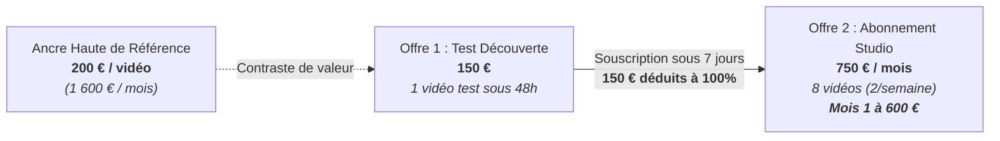

# AGENT404 : MODÈLE FINANCIER ET PLAN D'ENCAISSEMENT AU 31 DÉCEMBRE 2026

Statut de gouvernance : DOCUMENT FINANCIER MAÎTRE  
Date de référence : 28 octobre 2026  
Propriétaire : Kreesten AGBOTON (Abomey-Calavi, Bénin)  
Taux de conversion officiel de référence : 1 EUR = 655,957 FCFA (parité fixe zone Franc CFA)  
Horizon d'exécution : 64 jours (du 28 octobre 2026 au 31 décembre 2026)  

---

## 1. Cadrage de l'Objectif Financier Directeur (North Star)

L'unique objectif du projet AGENT404 est d'encaisser du cash réel avant la fin de l'exercice 2026.

| Indicateur | Valeur en FCFA | Valeur en Euros (€) | Statut méthodologique |
| :--- | :---: | :---: | :--- |
| **OBJECTIF MAÎTRE (North Star)** | **2 000 000 FCFA** | **≈ 3 049 €** | [OBJECTIF] Cible impérative au 31/12/2026 |
| **Plancher de repli réaliste** | **1 639 892 FCFA** | **2 500 €** | [OBJECTIF] Seuil de validation commerciale forte (82 %) |
| **Plancher de survie minimal** | **819 946 FCFA** | **1 250 €** | [OBJECTIF] Filet de sécurité en cas de friction sévère (41 %) |

Règle de gestion stricte : seul le cash effectivement crédité sur le compte bancaire est comptabilisé. Les promesses orales, intentions d'achat et factures émises non réglées valent 0 FCFA.

---

## 2. Situation Comptable Réelle au 28 Octobre 2026

| Poste comptable | Montant constaté | Statut d'audit |
| :--- | :---: | :--- |
| **Encaissements réels à date** | **0 € / 0 FCFA** | [DÉCLARÉ PAR LE FONDATEUR - NON VÉRIFIÉ EN MACHINE] 0 € encaissés à ce jour |
| **Factures émises non encaissées** | **0 € / 0 FCFA** | [DÉCLARÉ PAR LE FONDATEUR - NON VÉRIFIÉ EN MACHINE] Aucune créance client en cours |
| **Nombre de prospects qualifiés prêts** | **10** | [DÉCLARÉ PAR LE FONDATEUR - NON VÉRIFIÉ EN MACHINE] |
| **Preuve de marché réelle** | **Déclarée** | [DÉCLARÉ PAR LE FONDATEUR - NON VÉRIFIÉ EN MACHINE] Validation d'intérêt organique sur LinkedIn |
| **Montant restant à encaisser** | **2 000 000 FCFA** | [OBJECTIF] Soit environ 3 049 € à sécuriser d'ici le 31 décembre 2026 |

---

## 3. Structure des Coûts, Trésorerie & Quota Vocal

### A. Coûts variables de production
- **Génération vidéo locale (AGENT404)** : 0 € d'API vidéo par génération. Le pipeline tourne en local avec Playwright Chromium, Faster-Whisper et FFmpeg [FAIT VÉRIFIÉ].
- **Synthèse vocale (ElevenLabs)** :
  - **NOTE DE TRÉSORERIE CRITIQUE (Provision Quota Vocal)** :
    Dès l'encaissement du **premier Test Découverte (150 €)**, provisionner immédiatement **5 $ à 22 $ / mois** (environ 3 200 à 14 000 FCFA) pour faire passer le compte ElevenLabs du plan Gratuit (limité à ~10 000 caractères/mois, soit environ 10 vidéos courtes) au plan **Starter (5 $/m)** ou **Creator (22 $/m)** avec droits commerciaux.  
    Cette provision immédiate sanctuarise le quota vocal et évite tout blocage opérationnel dès la signature du premier client Studio (qui consomme à lui seul 8 vidéos par mois).
  - Si le client fournit sa propre note vocale WhatsApp ou son enregistrement vocal brut, le coût ElevenLabs est de 0 €.
- **Électricité et connectivité locale (Abomey-Calavi)** : Coût marginal estimé à 5 000 FCFA par mois de calcul machine [HYPOTHÈSE].

### B. Frais d'encaissement et commissions de paiement
- **Réception des fonds en devises (SEPA / International)** :
  - Option Moneco (compte avec IBAN européen pour la diaspora) : Réception virement SEPA, conversion et rapatriement local.
  - Option Ecobank Bénin : Virement SWIFT direct ou intermédiaire de paiement.
  - Règle opérationnelle : 100% des règlements sont perçus d'avance avant livraison des fichiers masters MP4.

### C. Temps de travail humain (temps de production)
- Ingestion du matériau brut (note vocale, post, doc, workflow), extraction du joyau d'idée, paramétrage de la timeline et validation acoustique.
- Temps estimé par vidéo : 45 min à 1h30 grâce à l'automatisation du moteur déterministe.

---

## 4. Architecture Tarifaire : Ancrage Psychologique & Parcours Client

L'offre commerciale AGENT404 repose sur un mécanisme d'ancrage psychologique à trois niveaux et une passerelle *foot-in-the-door* :

1. **Ancre Haute de référence (Hors abonnement)** : **200 € par vidéo** à l'unité ($8 \times 200\text{ €} = 1\,600\text{ €/m}$). Elle établit la valeur intrinsèque d'une capsule de niveau broadcast sur le marché.
2. **Offre 1 : Test Découverte** : **150 €** (environ **98 394 FCFA**).
   - Livrable : 1 vidéo verticale de niveau broadcast (1080x1920 @ 30 FPS, ~60s), livrée sous 48h.
   - **Clause d'Ancrage / Foot-in-the-door** : Les 150 € sont **100 % DÉDUITS** du premier mois d'Abonnement Studio si le client souscrit dans les 7 jours suivant la livraison du test.
3. **Offre 2 : Forfait Studio Mensuel** : **750 € par mois** (environ **491 968 FCFA par mois**).
   - Livrable : **8 vidéos verticales par mois** (2 vidéos livrées chaque semaine pour alimenter LinkedIn, TikTok, Reels et Shorts).
   - Contraste psychologique immédiat : revient à **93,75 € la vidéo** en Studio vs 200 € à l'unité (plus de 53 % d'économie perçue).
   - Coût du mois 1 post-Test Découverte : **600 €** (environ **393 574 FCFA**), soit $750 - 150\text{ €}$.

---

## 5. Calendrier d'Encaissement du Forfait Studio (Effet Mois Pleins)

L'Abonnement Studio (750 € par mois) est réglé d'avance à l'ouverture de chaque cycle mensuel.  
Dans l'intervalle restant du 28 octobre au 31 décembre 2026, les encaissements se cadencent selon la date de conversion :

| Date de conversion en Studio | Statut du premier mois | Cash collecté en 2026 par client (€) | Cash collecté en FCFA |
| :--- | :--- | :---: | :---: |
| Signature avant le 10 novembre | Nov (600 €) + Déc (750 €) + Test (150 €) | **1 500 €** | 983 936 FCFA |
| Signature mi-novembre (1,5 mois) | Acompte mi-nov (300 €) + Déc (750 €) + Test (150 €) | **1 200 €** | 787 148 FCFA |
| Signature début décembre (1 mois) | Décembre (600 €) + Test (150 €) | **750 €** | 491 968 FCFA |

---

## 6. Trois Scénarios d'Exécution Chiffrés

Les calculs reposent rigoureusement sur la parité officielle (1 EUR = 655,957 FCFA) et les deux offres actives :
- **Test Découverte** : 150 € (98 394 FCFA)
- **Abonnement Studio** : 750 € / mois (491 968 FCFA), premier mois à 600 € (393 574 FCFA) après déduction du Test.

### Scénario 1 : Prudent (Friction commerciale & retards d'amorçage)
- *Hypothèses* : Démarrage fin octobre. 30 prospects contactés, frictions et hésitations, conversion tardive en studio.
- *Ventes réalisées* :
  - 3 Tests Découverte vendus (2 en nov, 1 en déc) : $3 \times 150\text{ €} = 450\text{ €}$ (295 181 FCFA)
  - 1 seul client Découverte converti en Studio pour décembre uniquement : $1 \times 600\text{ €} = 600\text{ €}$ (393 574 FCFA)
- *Encaissement total* : **1 050 €** (environ **688 755 FCFA**).
- *Taux d'atteinte de la cible* : **34,4 %**.
- *Bilan* : Modèle commercial et pipeline validés avec de vrais clients payants, 11 vidéos livrées, base récurrente sécurisée pour janvier 2027.

### Scénario 2 : Réaliste (Exécution commerciale rigoureuse)
- *Hypothèses* : Démarrage immédiat sur le Top 10 qualifié (`prospects.csv`). Contacts personnalisés avec pitch centré sur le problème du tournage vidéo.
- *Ventes réalisées* :
  - 4 Tests Découverte vendus : $4 \times 150\text{ €} = 600\text{ €}$ (393 574 FCFA)
  - 1 client Découverte converti en Studio sur 2 mois (nov à 600 € + déc à 750 €) : $1\,350\text{ €}$ (885 542 FCFA)
  - 1 client Studio direct signé pour décembre : $1 \times 750\text{ €} = 750\text{ €}$ (491 968 FCFA)
- *Encaissement total* : **2 700 €** (environ **1 771 084 FCFA**).
- *Taux d'atteinte de la cible* : **88,5 %**.
- *Bilan* : Encaissement solide de plus de 1,77 million FCFA. Le seuil de repli réaliste (1,64 million FCFA) est largement dépassé.

### Scénario 3 : Ambitieux (Franchissement net des 2 000 000 FCFA)
- *Hypothèses* : Excellente résonance du format 60s sans caméra, retours rapides, 2 clients convertis en Studio dès début novembre après leur test.
- *Ventes réalisées* :
  - 4 Tests Découverte vendus au total : $4 \times 150\text{ €} = 600\text{ €}$ (393 574 FCFA)
  - 2 clients Découverte convertis en Studio sur 2 mois complets (nov à 600 € + déc à 750 € par client = $2 \times 1\,350\text{ €} = 2\,700\text{ €}$, soit 1 771 084 FCFA)
- *Encaissement total net* : **3 300 €** (environ **2 164 658 FCFA**).
- *Taux d'atteinte de la cible* : **108,2 %**.
- *Bilan* : **Objectif majeur de 2 000 000 FCFA franchi et dépassé de 164 658 FCFA avant le 31 décembre 2026.**

---

## 7. Démonstration Mathématique : Comment 2 Clients Studio Franchissent les 2 000 000 FCFA

Pour encaisser les 2 000 000 FCFA (soit 3 049 €) avant le 31 décembre 2026, la démonstration mathématique prouve qu'il n'est pas nécessaire de prospecter des dizaines de clients. **Le levier Studio résout l'équation avec seulement 2 clients fidélisés :**

### La Formule Directe (Option A : Recommandée) :
$$\text{2 Clients Studio sur 2 mois} + \text{1 Test Découverte isolé} = 3\,150\text{ €} \ (2\,066\,265\text{ FCFA})$$

- **Client 1** : Test Découverte (150 €) + Mois 1 nov (600 €) + Mois 2 déc (750 €) = **1 500 €**
- **Client 2** : Test Découverte (150 €) + Mois 1 nov (600 €) + Mois 2 déc (750 €) = **1 500 €**
- **Test Découverte isolé** (client non encore converti en Studio) : **150 €**
- **TOTAL NET ENCAISSÉ** : **3 150 €** (soit **2 066 265 FCFA** $\rightarrow$ **103,3 % de la North Star atteinte !**).

### Comparaison des Stratégies d'Atteinte :
1. **Option A (Voie Royale Studio : 2 clients)** : 2 clients Studio fidélisés nov+déc + 1 test = **3 150 €** (2 066 265 FCFA). *Effort commercial minimal : closer seulement 2 décideurs sur l'abonnement mensuel.*
2. **Option B (Forte récurrence échelonnée)** : 1 client Studio 2 mois (1 500 €) + 2 clients Studio 1 mois (1 500 €) + 1 test (150 €) = **3 150 €** (2 066 265 FCFA).
3. **Option C (Pure acquisition Découverte sans rétention)** : Vendre 21 Tests Découverte à 150 € chacun = **3 150 €** (2 066 265 FCFA). *Nécessite 21 clients distincts en 70 jours : effort d'acquisition 10x plus élevé, justifiant le focus absolu sur la conversion en Studio.*

---

## 8. Les 3 Cibles Précises & Qualification Chirurgicale

### Critère Absolu d'Éligibilité (La Règle d'Or)
> **« Ils créent DÉJÀ du contenu écrit régulier sur LinkedIn (3 à 5 posts par semaine), mais ils n'ont AUCUNE vidéo (ou des vidéos face-caméra mal fichues et amateurs). »**

Si un prospect ne publie pas à l'écrit, il n'a pas de matière première à recycler : disqualifié d'office.  
S'il a déjà une équipe vidéo interne (grosses boîtes/licornes), il n'a pas besoin de studio externe : disqualifié d'office.

### Les 3 Profils Qualifiés
1. **Cible 1 : Les Fondateurs d'Agences B2B & Studios Productisés**
   - *Domaines* : Webflow, Bubble, Automatisation Make/n8n/IA, SEO, Cold Email, Ghostwriting.
   - *Exemple type* : Le créateur de la vidéo « Le métro de Londres », Digidop, Noqode.
   - *Painkiller* : Leurs études de cas écrites sont riches mais leurs prospects ne lisent plus les longs PDF. Tourner des vidéos leur prendrait 4h de studio par semaine.
   - *Bénéfice AGENT404* : Transformer chaque cas client ou workflow en une vidéo 60s percutante sans caméra.
2. **Cible 2 : Les Formateurs, Infopreneurs Tech & Créateurs B2B**
   - *Domaines* : Dév, IA, No-Code, Finance, Cybersécurité, Copywriting.
   - *Exemples* : Créateurs solos experts, formateurs Ottho, Contournement.
   - *Painkiller* : Les concepts techniques sont abstraits. Leurs carrousels LinkedIn atteignent un plafond de verre.
   - *Bénéfice AGENT404* : Des capsules néo-brutalistes dynamiques qui vulgarisent des architectures complexes et renvoient vers leurs formations.
3. **Cible 3 : Les Consultants & Solopreneurs B2B très actifs à l'écrit**
   - *Domaines* : Recrutement tech, gouvernance cyber, intégration CRM, stratégie financière.
   - *Painkiller* : Ils écrivent 5 posts par semaine sur LinkedIn avec une forte autorité, mais ont zéro présence vidéo par manque de temps et peur du tournage amateur.
   - *Bénéfice AGENT404* : Dominer leur niche avec 2 vidéos professionnelles par semaine en envoyant simplement le lien de leur meilleur post ou une note vocale WhatsApp de 2 minutes.

---

## 9. Application des 5 Concepts Directeurs

1. **Concept 1 (Problème précis)** : Ne plus vendre « du code Python », mais vendre la fin de la corvée du tournage vidéo pour les créateurs LinkedIn B2B.
2. **Concept 2 (Fonctionnement étape par étape)** : Cycle standardisé : note vocale WhatsApp / lien de post $\rightarrow$ extraction de la pépite $\rightarrow$ test 48h à 150 € $\rightarrow$ conversion Studio 750 €/m avec déduction des 150 €.
3. **Concept 3 (Non-objectifs clairs)** : Refus d'afficher des prix dans les vidéos publiques, refus de remises non contractuelles, refus des prospects inactifs à l'écrit.
4. **Concept 4 (Constat précis mesuré)** : Rapprochement bancaire strict entre le cash encaissé en euros, converti au taux officiel (655,957), et la jauge des 2 000 000 FCFA.
5. **Concept 5 (Critères d'acceptation testables)** : L'objectif est validé le jour où le compte bancaire affiche au moins 2 000 000 FCFA crédités.
