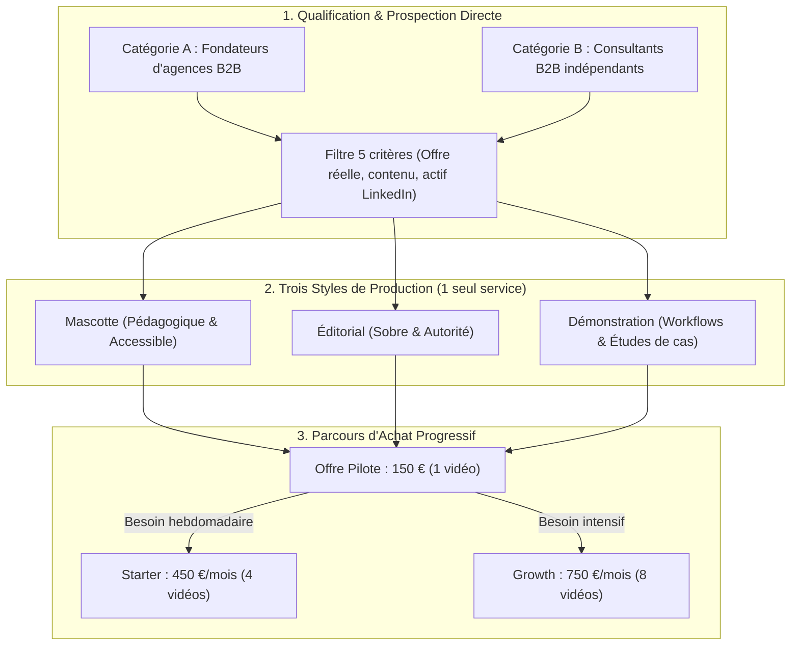

# ENGINE D'ACQUISITION LINKEDIN AGENT404 (90 JOURS)
### Guide Opérationnel, Personal Branding & Protocoles de Prospection B2B

**Date de référence** : 28 octobre 2026 (Mise à jour stratégique : 30 octobre 2026)  
**Fondateur** : Kreesten AGBOTON  
**Studio** : AGENT404 - Production de vidéos courtes pour le personal branding des experts B2B sur LinkedIn  
**URL Profil** : `www.linkedin.com/in/kreesten-agboton`  
**Canal Maître** : LinkedIn (80 % du volume d'acquisition du studio)

---

## 1. VISION & ARCHITECTURE DU SYSTÈME (VERROUILLÉE 30 JOURS)

Ce document formalise le moteur d'acquisition B2B d'AGENT404 autour d'une règle stricte : **vendre la transformation de l'expertise écrite ou vocale des dirigeants B2B en vidéos animées régulières, sans tournage ni montage**.

Il combine :
1. L'alignement du profil LinkedIn du fondateur avec le positionnement retenu.
2. Le ciblage séparé des deux catégories prioritaires (Fondateurs d'agences B2B et Consultants B2B indépendants) avec un filtre de qualification exigeant.
3. La présentation des 3 styles de production (**Mascotte**, **Éditorial**, **Démonstration**).
4. L'entonnoir commercial progressif : **Pilote (150 €)** $\rightarrow$ **Starter (450 €/mois, 4 vidéos)** $\rightarrow$ **Growth (750 €/mois, 8 vidéos)**.



---

## 2. PILIER 1 : INFRASTRUCTURE DU PROFIL LINKEDIN & POSITIONNEMENT

### A. Positionnement Officiel d'AGENT404
> **AGENT404**  
> **Production de vidéos courtes pour le personal branding des experts B2B sur LinkedIn.**  
> Nous transformons les publications LinkedIn et les notes vocales des fondateurs d'agences B2B et consultants en vidéos animées professionnelles, sans tournage ni montage.  
> **8 vidéos par mois. Votre expertise, notre production.**

### B. Profil Personnel (Kreesten AGBOTON)

Le profil doit faire comprendre en quelques secondes : qui nous aidons, quel problème nous résolvons, ce que nous produisons et à quoi ressemble le résultat.

| Élément | Spécification déployée | Règle d'autorité |
| :--- | :--- | :--- |
| **Photo de profil** | Portrait studio détouré sur fond jaune `#F5D34F` ([`kreesten_cutout_tight.png`](../profil_linkedin/kreesten_cutout_tight.png)). | Contraste immédiat dans le fil d'actualité mobile. |
| **Bannière (1584×396)** | Charte jaune studio `#F5D34F` et ardoise, photo bras croisés, badge DM direct ([`assets/linkedin_banner_1584x396.png`](../assets/linkedin_banner_1584x396.png)). | Promesse claire visible en 2 secondes. |
| **Titre (Headline)** | `J'aide les fondateurs d'agences B2B et consultants à transformer leurs contenus LinkedIn en vidéos animées, sans tournage ni montage.` | Positionnement limpide et direct, centré sur le service livré. |
| **Infos (About)** | Explique la transformation des publications LinkedIn et notes vocales en vidéos animées selon 3 styles (Mascotte, Éditorial, Démonstration), sans promettre de vues irréalistes. | Zéro tiret cadratin, zéro jargon technique inutile. |
| **Bouton Personnalisé** | Nom : `Contactez-nous` / URL : `https://www.linkedin.com/in/kreesten-agboton` / Visibilité : `Activé`. | Redirige le trafic qualifié vers la messagerie privée. |

### C. Section Sélection (Featured) : Preuves Visuelles

1. **Carte Gauche (Média)** : [`featured_card_1_fr.png`](../profil_linkedin/featured_card_1_fr.png) (1200×675 px)
   - *Titre* : `Studio AGENT404 : Vos publications LinkedIn et notes vocales en vidéos animées`
   - *Description* :
     ```text
     Production de vidéos courtes pour le personal branding des fondateurs d'agences B2B et consultants sur LinkedIn.

     À partir de vos publications écrites ou de vos notes vocales :
     • Sélection des idées et structuration du script.
     • 3 styles adaptés à votre identité : Mascotte, Éditorial ou Démonstration.
     • Vidéos prêtes à publier sur LinkedIn, YouTube Shorts, Reels et TikTok.

     Votre expertise, notre production. Sans tournage ni montage.
     ```

2. **Carte Centrale (Post Carrousel)** : [`carrousel_mecanisme_agent404.pdf`](../profil_linkedin/carousel/carrousel_mecanisme_agent404.pdf) (1600×900 px, 5 slides)
   - *Rôle* : Présentation claire du processus de transformation d'un post ou vocal en vidéo animée.

3. **Carte Droite (Média)** : [`featured_card_2_fr.png`](../profil_linkedin/featured_card_2_fr.png) (1200×675 px)
   - *Titre* : `Vidéo Pilote : Testez la transformation d'un de vos contenus B2B`
   - *Description* :
     ```text
     Testez notre production sur l'une de vos publications LinkedIn ou notes vocales avant tout abonnement.

     Le fonctionnement :
     1. Vous nous transmettez un post écrit, une étude de cas ou une note vocale.
     2. Nous structurons le script et produisons une vidéo verticale de 45 à 60 secondes.
     3. Vous validez le rendu et décidez ensuite du rythme (4 ou 8 vidéos par mois).

     Pour lancer un pilote : écrivez-moi en message privé ou à agent404studio@gmail.com.
     ```

---

## 3. PILIER 2 : LIGNE ÉDITORIALE DU FONDATEUR (DEMONSTRATION DU SAVOIR-FAIRE)

Les publications de Kreesten AGBOTON ne doivent **jamais** transformer le profil en un compte qui republie les dernières nouveautés IA. Chaque post doit démontrer le savoir-faire du studio :

| Jour | Format | Angle éditorial | Objectif |
| :--- | :---: | :--- | :--- |
| **Lundi** | Post texte / Avant-Après | **Transformation d'un post écrit en script vidéo** : montrer comment on extrait l'idée directrice d'un texte B2B dense. | Prouver la compétence éditoriale et narrative. |
| **Mardi** | Extrait vidéo / Image | **Présentation des 3 styles (Mascotte, Éditorial, Démonstration)** : montrer comment on adapte le visuel au positionnement du client. | Rassurer les profils sobres comme les profils pédagogiques. |
| **Mercredi** | Carrousel / Processus | **Les coulisses du studio** : comment une note vocale de 2 minutes devient une vidéo rythmée sans que le client n'allume une caméra. | Mettre en avant le gain de temps et la simplicité. |
| **Jeudi** | Étude de cas / Analyse | **Réutilisation de l'expertise B2B** : pourquoi une bonne idée écrite mérite un second cycle de vie en vidéo sur 4 plateformes. | Éduquer sur la régularité et la présence multicanale. |
| **Vendredi** | Vidéo MP4 native | **Démonstration complète (`video_01_decouverte` / `video_03` / réalisations)** : preuve directe de la qualité d'animation et du son. | Générer des conversations privées vers l'offre Pilote. |

---

## 4. PILIER 3 : PROSPECTION DIRECTE & QUALIFICATION EXIGEANTE

### A. Les 2 Catégories Ciblées Séparément
1. **Fondateurs de petites agences B2B** (automatisation, développement web, CRM, no-code, marketing spécialisé).
2. **Consultants B2B indépendants** (qui vendent une expertise ou un accompagnement).

### B. La Grille de Qualification Obligatoire (5 Critères)
Avant d'ajouter un prospect ou de lui écrire, vérifier qu'il coche ces 5 points :
1. Il vend réellement un service ou un accompagnement B2B.
2. Il a une activité commerciale identifiable.
3. Il dispose de suffisamment de contenu et d'expertise (posts écrits, études de cas, méthodes).
4. Il utilise LinkedIn pour développer son activité (3 à 5 publications par semaine).
5. Il n'a pas déjà une production vidéo régulière satisfaisante.

### C. Approche de Contact Directe et Sobre
- **Règle** : Ne pas fabriquer gratuitement une vidéo personnalisée pour chaque inconnu. Utiliser nos 2 vidéos de démonstration existantes ([`video1.mp4`](../studio_perso/video_01_decouverte/video1.mp4) et [`video3.mp4`](../studio_perso/video_03/video3.mp4)) comme preuves du savoir-faire.
- **Trame de prise de contact** :
  ```text
  Bonjour [Prénom],

  J'ai lu votre publication sur [sujet précis ou étude de cas]. L'explication sur [point précis] est très claire.

  Avec AGENT404, nous aidons les fondateurs d'agences B2B et les consultants à transformer leurs publications LinkedIn et notes vocales en courtes vidéos animées (style éditorial, démonstration ou mascotte), sans tournage ni montage.

  Nous proposons une vidéo pilote à 150 € pour tester le format sur l'un de vos contenus existants, avant d'envisager un rythme régulier (4 ou 8 vidéos par mois).

  Est-ce un format que vous avez déjà envisagé pour décliner vos publications écrites en vidéo ?
  ```

---

## 5. RÈGLES DE GOUVERNANCE ÉDITORIALE (ANTI-SLOP STRICT)

1. **Zéro tiret cadratin** : Les tirets cadratins sont formellement proscrits dans tous les textes, légendes et messages privés.
2. **Zéro prix dans les vidéos publiques** : Aucun tarif (150 €, 200 €, 450 €, 750 €) ne doit figurer dans les vidéos publiques.
3. **Zéro promesse commerciale non maîtrisée** : Ne jamais promettre un nombre de vues, de prospects ou de ventes. Promettre uniquement le gain de temps, la réutilisation de l'expertise, la régularité et la présence multicanale.
4. **Zéro jargon IA creux** : Bannir *delve*, *leverage*, *tapestry*, *écosystème*, *passionné*, *révolutionnaire*, *synergie*.
