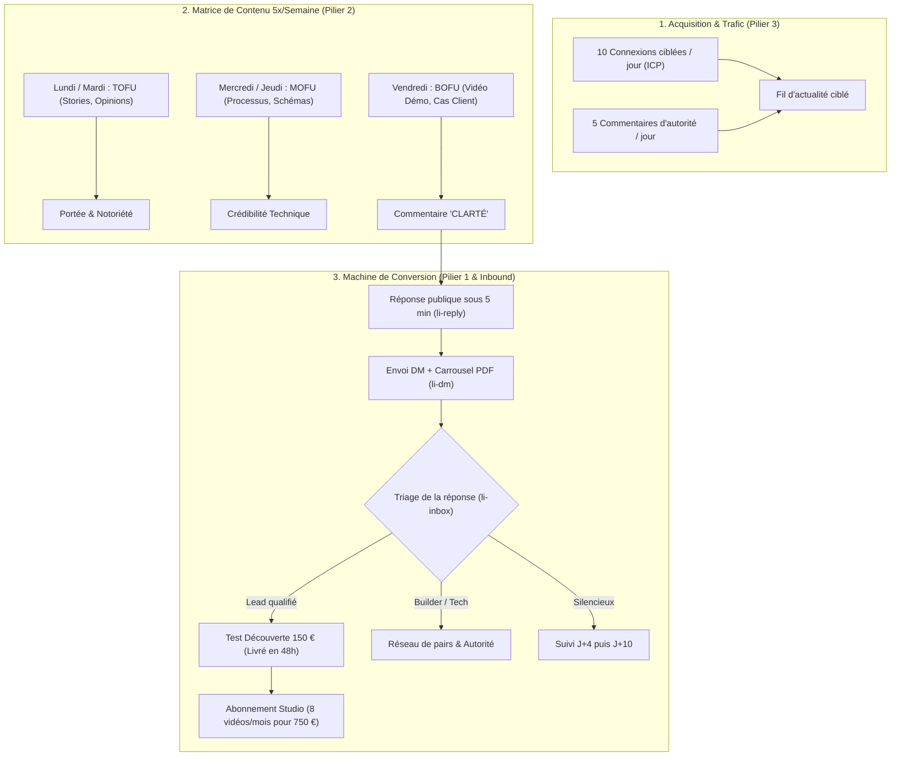

# ENGINE D'ACQUISITION LINKEDIN AGENT404 (90 JOURS)
### Guide Opérationnel, Stratégie de Contenu Funnel & Protocoles de Conversion Inbound

**Date de référence** : 29 octobre 2026  
**Fondateur** : Kreesten AGBOTON  
**Studio** : AGENT404 (« Zero-Camera, Zero-Studio & Zero-Montage »)  
**URL Profil** : `www.linkedin.com/in/kreesten-agboton`  
**Canal Maître** : LinkedIn (80 % du volume d'acquisition du studio)

---

## 1. VISION & ARCHITECTURE DU SYSTÈME

Ce document formalise l'intégralité du moteur d'acquisition B2B d'AGENT404. Il combine :
1. L'optimisation complète de l'infrastructure de profil (score 90+/100).
2. La matrice de contenu hebdomadaire en 5 publications (Framework 90 jours Top/Middle/Bottom of Funnel inspiré de Denis Panjuta).
3. Le protocole de conversion inbound et de traitement des messages privés (« CLARTÉ »).
4. La routine quotidienne d'engagement actif (20 minutes par jour).



---

## 2. PILIER 1 : INFRASTRUCTURE DU PROFIL & DE LA PAGE ENTREPRISE

### A. Profil Personnel (Kreesten AGBOTON)

| Élément | Spécification déployée | Règle d'autorité |
| :--- | :--- | :--- |
| **Photo de profil** | Portrait studio détouré sur fond jaune `#F5D34F` ([`kreesten_cutout_tight.png`](../profil_linkedin/kreesten_cutout_tight.png)). | Contraste immédiat dans le fil d'actualité mobile. |
| **Bannière (1584×396)** | Charte jaune studio `#F5D34F` et ardoise, photo bras croisés, badge DM direct ([`assets/linkedin_banner_1584x396.png`](../assets/linkedin_banner_1584x396.png)). | Promesse claire visible en 2 secondes. |
| **Titre (Headline)** | `8 vidéos 60s par mois pour fondateurs d’agences et consultants B2B \| Moteur sans caméra : générées depuis vos posts écrits ou notes vocales \| Écrivez directement en DM pour voir le rendu` | Formulé en résultat client, zéro cliché « J'aide les X ». |
| **Infos (About)** | Format direct "vous", safe-area mobile respectée, contraste tournage vs moteur vidéo, appel direct en DM et email (`agent404studio@gmail.com`). | Zéro tiret cadratin, zéro mot creux robotique. |
| **Bouton Personnalisé Premium** | Nom : `Contactez-nous` / URL : `https://www.linkedin.com/in/kreesten-agboton` / Visibilité : `Activé`. | Redirige tout le trafic vers la messagerie privée. |

### B. Section Sélection (Featured) : La Trinité Visuelle

La section Sélection est harmonisée en 3 volets avec halo radial jaune `#F5D34F` :

1. **Carte Gauche (Média)** : [`featured_card_1_fr.png`](../profil_linkedin/featured_card_1_fr.png) (1200×675 px)
   - *Titre* : `Studio AGENT404 : 8 vidéos B2B par mois sans caméra ni tournage`
   - *Description* :
     ```text
     Studio de production vidéo court-format pour agences et consultants B2B.

     À partir de vos posts écrits ou d'un vocal de 2 minutes :
     • 8 vidéos de 60 secondes livrées chaque mois (2 par semaine).
     • Avatar cel-shaded incarné, voix studio et motion design au mot près.
     • 1 idée diffusée sur LinkedIn, YouTube Shorts, Reels et TikTok.

     Zéro caméra, zéro studio, zéro temps perdu au montage.

     Écrivez-moi directement en message privé pour échanger.
     ```

2. **Carte Centrale (Post Carrousel)** : [`carrousel_mecanisme_agent404.pdf`](../profil_linkedin/carousel/carrousel_mecanisme_agent404.pdf) (1600×900 px, 5 slides)
   - *Rôle* : Présentation didactique de l'Entrée Agnostique, du découpage 60s et des 4 canaux actifs.

3. **Carte Droite (Média)** : [`featured_card_2_fr.png`](../profil_linkedin/featured_card_2_fr.png) (1200×675 px)
   - *Titre* : `Test Découverte 48h : Votre 1re vidéo 60s livrée depuis un post ou un vocal`
   - *Description* :
     ```text
     Validez la puissance du format sur votre marque sans engagement.

     Le fonctionnement :
     1. Envoyez-moi un post écrit récent ou une note vocale de 2 minutes.
     2. Notre moteur extrait l'argument fort et calibre le script 60 secondes.
     3. Recevez votre vidéo verticale de calibre broadcast livrée sous 48h.

     Avatar incarné, sous-titres dynamiques et sound design inclus.

     Pour lancer votre test : envoyez un DM ou écrivez à agent404studio@gmail.com.
     ```

### C. Page Entreprise (AGENT404)

- **Slogan officiel (< 120 caractères)** :
  `De la complexité technique à la clarté vidéo en 60 secondes. Sans caméra ni montage.`
- **Description officielle (Section Infos)** :
  ```text
  AGENT404 transforme les posts écrits, notes vocales et schémas des entreprises tech et agences en vidéos verticales de 60 secondes, sans caméra ni tournage.

  Chaque capsule réunit script haute rétention, avatar cel-shaded, motion design et mixage studio. Nous livrons 8 vidéos prêtes à poster par mois, optimisées pour LinkedIn, YouTube Shorts, Reels et TikTok, et intégrons nos pipelines de génération vidéo pour vos équipes.
  ```

---

## 3. PILIER 2 : LA MATRICE DE CONTENU HEBDOMADAIRE (5 POSTS / SEMAINE)

Le rythme de publication repose sur l'alternance rigoureuse des 3 étapes du tunnel de vente :

| Jour | Étape Funnel | Format | Objectif psychologique | Thématiques types AGENT404 |
| :--- | :---: | :---: | :--- | :--- |
| **Lundi** | **TOFU** | Post texte aéré | Identification & Vulnérabilité | Les dimanches perdus sur Premiere Pro ; bafouiller 20 prises face caméra ; le coût caché du tournage pour un dirigeant. |
| **Mardi** | **TOFU** | Post texte ou image | Polarisation & Opinion tranchée | Pourquoi les faux clones IA (visages artificiels) détruisent la confiance des prospects ; le retour en force de l'incarnation néo-brutaliste. |
| **Mercredi** | **MOFU** | Carrousel PDF ou Schéma | Démonstration du Processus | Anatomie d'une capsule de 60s ; comment une note vocale WhatsApp de 2 min est traduite en timeline programmatique synchronisée au millième. |
| **Jeudi** | **MOFU** | Post éducatif / Guide | Valeur actionnable pour l'ICP | Comment recycler une étude de cas Webflow ou un flux Make/n8n en capsule vidéo courte pour doubler ses demandes entrantes. |
| **Vendredi** | **BOFU** | Vidéo MP4 native | Démonstration réelle & Vente | Diffusion d'une vidéo produite par le moteur (ex: Vidéo Manifeste ou cas client) avec appel à commenter « CLARTÉ » pour tester en 48h. |
| **Samedi / Dim** | **OFF** | Repos | Préservation de l'algorithme | Zéro publication. L'algorithme continue de faire tourner les publications de jeudi et vendredi. |

---

## 4. PILIER 3 : LA ROUTINE QUOTIDIENNE DE 20 MINUTES

Pour que l'algorithme LinkedIn pousse vos publications auprès des bonnes personnes, appliquez ce protocole quotidien (idéalement entre 8h00 et 8h30, ou entre 12h00 et 12h30) :

1. **Ajouter 10 profils qualifiés par jour** :
   - Cibler exclusivement : Fondateurs d'agences Webflow, agences SEO, studios d'automatisation (Make/n8n/IA), consultants tech/finance qui publient déjà chaque semaine à l'écrit.
   - Envoyer la note d'invitation courte (< 200 caractères) sans pitch ni lien.
2. **Commenter 5 publications d'autorité par jour (`li-comment`)** :
   - Identifier 5 créateurs ou dirigeants influents que votre ICP suit déjà.
   - Laisser un commentaire constructif de 3 à 4 phrases apportant un éclairage d'ingénierie ou de méthode. Votre titre de profil apparaîtra directement sous les yeux des prospects.
3. **Le Protocole de la Golden Hour (Post-Publication)** :
   - Dès la publication mise en ligne, poster et épingler immédiatement le premier commentaire contenant la double porte.
   - Pendant les 45 premières minutes, répondre à 100 % des commentaires reçus avec des phrases de plus de 5 mots et une relance ouverte.

---

## 5. PILIER 4 : LE PROTOCOLE DE CONVERSION INBOUND (« CLARTÉ »)

### A. Réponse publique sous le commentaire (`li-reply`)
Répondre publiquement à chaque personne qui commente « CLARTÉ » pour doubler le nombre de commentaires et valider la réactivité du studio :
- `C'est envoyé dans tes messages privés [Prénom].`
- `Bien reçu [Prénom], je viens de te glisser le document en DM.`
- `Je t'ai partagé le schéma en message privé [Prénom].`

### B. Message privé de livraison du Blueprint (`li-dm`)
Joindre le fichier PDF [`carrousel_mecanisme_agent404.pdf`](../profil_linkedin/carousel/carrousel_mecanisme_agent404.pdf) et envoyer :

```text
Hello [Prénom],

Voici le document complet sur le fonctionnement d'AGENT404, avec le schéma du pipeline sans caméra.

Je l'ai conçu avec deux angles :
1. Pour disséquer la mécanique technique et voir comment le code assemble l'audio, l'avatar et le rendu final.
2. Pour voir concrètement comment transformer un post écrit ou un vocal en vidéo 60 secondes prête à diffuser.

Qu'est-ce qui t'a le plus intrigué dans la vidéo ?
```

### C. Triage et qualification des réponses (`li-inbox`)

* **Cas 1 : Le contact est un Lead qualifié**  
  *Exemple : « Je manque de temps pour tourner », « Comment ça marche pour moi ? »*  
  *Réponse* : Proposer le Test Découverte 48h sans engagement sur un de ses posts récents ou une note vocale de 2 min. (Tarif de 150 € communiqué uniquement s'il demande le prix, avec la clause de déduction intégrale du 1er mois d'abonnement).

* **Cas 2 : Le contact est un Builder / Pair technique**  
  *Exemple : « C'est quoi la stack ? », « C'est codé en Python ? »*  
  *Réponse* : Échange d'autorité confraternel sur Whisper, le DOM sans framework lourd et FFmpeg image par image.

* **Cas 3 : Absence de réponse**  
  - *Relance à J+4* : Apporter une nouvelle valeur (ex: découpe d'une structure de rétention 60s).  
  - *Clôture à J+10* : Message de fermeture de boucle propre, sans pression.

---

## 6. RÈGLES DE GOUVERNANCE ÉDITORIALE (ANTI-SLOP STRICT)

1. **Zéro tiret cadratin** : Les tirets cadratins sont formellement proscrits dans tous les textes, légendes et messages privés.
2. **Zéro prix public** : Aucun tarif (150 €, 750 €) ne doit figurer publiquement sur la bannière, le titre ou les posts. Les tarifs sont réservés aux échanges privés.
3. **Zéro mot creux d'IA** : Bannir strictement *delve*, *leverage*, *tapestry*, *écosystème*, *passionné*, *révolutionnaire*, *synergie*.
4. **Appel à l'action direct** : Privilégier les DM LinkedIn et l'email `agent404studio@gmail.com`. Aucun mot-clé d'automatisation artificielle de type « Commentez DÉMO ».
