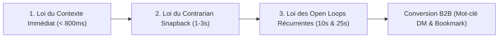

# VIRAL CONTENT ENGINE // LA BIBLE DE RÉTENTION & CONVERSION B2B
## Manuel d'Ingénierie Narrative & Algorithmique (Studio AGENT404)

> Ce document est la **référence stratégique et opérationnelle** du studio AGENT404 pour concevoir, structurer et scripter des vidéos courtes (9:16 vertical, LinkedIn, Instagram Reels, TikTok, YouTube Shorts) à haute rétention ($> 85\%$ de watch time moyen) et forte conversion B2B sans visage ni caméra.
> 
> Il synthétise les enseignements des **6 formats viraux d'élite** disséqués via notre pipeline `watch` et les connecte directement à notre moteur Video-as-Code et à nos **9 Blueprints Universels**.

---

### SOMMAIRE
1. [Section I — Les 3 Lois Physiques de la Rétention Verticale](#section-i--les-3-lois-physiques-de-la-r%C3%A9tention-verticale)
2. [Section II — Décodage Anatomique des 6 Formats d'Élite](#section-ii--d%C3%A9codage-anatomique-des-6-formats-d%C3%A9lite)
3. [Section III — Le Générateur de Scripts en 8 Nœuds (Template Universel)](#section-iii--le-g%C3%A9n%C3%A9rateur-de-scripts-en-8-n%C5%93uds-template-universel)
4. [Section IV — Matrice de Correspondance Formats ↔ 9 Blueprints Universels](#section-iv--matrice-de-correspondance-formats--9-blueprints-universels)
5. [Section V — Guide d'Application par Archétype Client B2B](#section-v--guide-dapplication-par-arch%C3%A9type-client-b2b)
6. [Section VI — Grille d'Évaluation & Checklist d'Audit Viral (Score /100)](#section-vi--grille-d%C3%A9valuation--checklist-daudit-viral-score-100)

---

### Section I — Les 3 Lois Physiques de la Rétention Verticale

Toute vidéo courte en flux mobile (Instagram Reel, TikTok, Shorts, LinkedIn) est soumise à une friction cognitive brutale : **l'utilisateur peut glisser le pouce en moins de 400 millisecondes**. Trois lois physiques régissent la rétention :



#### 1. Loi du Contexte Immédiat ($< 800\text{ ms}$)
* **Constat scientifique (Kallaway)** : Les spectateurs ne regardent que ce dans quoi ils ont un intérêt direct et immédiat. Reporter le contexte à la deuxième moitié de la première phrase fait chuter le taux de maintien de plus de 50%.
* **Règle d'or** : Le sujet et la cible doivent être articulés **en audio, en texte central et en visuel simultanément dès la première seconde**.
* **Interdiction formelle** : Les ouvertures molles de type *"Salut tout le monde, aujourd'hui je voulais vous parler de..."* sont interdites.

#### 2. Loi du Contrarian Snapback (La Rupture Cognitive)
* **Constat narratif** : Moins de 1% des créateurs maîtrisent ce levier. Pour ferrer l'attention, il faut orienter l'esprit du spectateur dans une direction attendue, puis tirer brutalement la ligne dans la direction opposée.
* **Mécanique** :
  1. *L'inclinaison (The Lean)* : Énoncer une croyance ou douleur universelle (*"Tu passes des heures à chercher des clients par message..."*).
  2. *Le Snapback* : Démolir cette croyance (*"...mais ce n'est pas ton pitch qui pose problème, c'est que personne ne signe de contrat B2B sur un texte sans incarnation."*).

#### 3. Loi des Open Loops Récurrentes (Anti-Décrochage à 10s et 25s)
* **Effet Zeigarnik** : Le cerveau humain déteste laisser une tâche ou une histoire inachevée.
* **Mécanique** : Une vidéo ne doit jamais délivrer toute sa valeur d'un coup. Dès qu'une pépite de valeur est délivrée ($t=8\text{s}$), ouvrir immédiatement une boucle avant que le spectateur ne parte (*"Mais il y a un piège mortel que 99% des gens ignorent..."*), puis réitérer à mi-parcours ($t=20\text{s}$).

---

### Section II — Décodage Anatomique des 6 Formats d'Élite

Nos analyses détaillées dans [references/CATALOGUE_FORMATS.md](../references/CATALOGUE_FORMATS.md) ont extrait l'ADN de 6 styles viraux majeurs :

| Réf | Créateur | Concept & Promesse | Durée | Cadence Cuts | Blueprint Clé | Levier Psychologique |
| :---: | :--- | :--- | :---: | :---: | :--- | :--- |
| **01** | **Jun Yuh** | *Choosing the niche vs Becoming the niche* | 60.3s | 1 cut / 1.28s | `bp_split_timeline` | Aversion au gaspillage & Projection temporelle |
| **02** | **Mindura** | *Génération de textes animés via Claude Code CLI* | 87.7s | 1 cut / 2.10s | `bp_code_window` | Effet de transparence & Démonstration brute |
| **03** | **Sky Tan** | *The Ultimate Storytelling Caption Structure* | 55.9s | 1 cut / 1.80s | `bp_stat_shock` + `bp_cta_conversion` | Ancrage de rentabilité & Double Entonnoir |
| **04** | **ContentMap**| *20 Formats Viraux de Reels (Le Listicle)* | 17.4s | 1 cut / 0.80s | `bp_grid_2x2` | Effet de profusion (Swipe file mental) |
| **05** | **Kallaway** | *The Triple Hook Method (Hook impossible à scroller)*| 134.2s| 1 cut / 5.36s | `bp_hook_question` | Open Loop par cartouche flouté & Règle des 800ms |
| **06** | **Peter Visuals**| *Formula for Viral Content (8-Node Retention Loop)* | 23.5s | 1 cut / 0.98s | `bp_grid_2x2` + Caméra | Rétention spatiale & Inversion de contraste |

---

#### 1. Format Jun Yuh — Le Split-Screen Temporel (`01_jun_yuh_split_screen`)
* **Visualisation** : Écran divisé en 2 colonnes égales (Gauche : Voie classique / Droite : Voie Agent404) chapeauté par une pilule temporelle (`top-milestone-bar`).
* **Progression temporelle** : `JOUR 1` $\rightarrow$ `MOIS 1` $\rightarrow$ `MOIS 3` $\rightarrow$ `MOIS 6` $\rightarrow$ `1 AN`.
* **Impact** : Démontre la supériorité d'un système sans avoir à argumenter théoriquement : les compteurs de résultats du bas parlent d'eux-mêmes (ex: `0 Lead / Abandon` VS `24 Vidéos / Autorité`).

#### 2. Format Mindura — L'Autopsie & Démonstration Terminal (`02_mindura_claude_code`)
* **Visualisation** : Fenêtre Mac/Linux Néo-Brutaliste (`bp_code_window`) avec lignes de terminal qui défilent en temps réel.
* **Rupture narrative** : Prouver par l'exécution machine que le rendu est automatisé et déterministe. Élimine le scepticisme technique des décideurs B2B.

#### 3. Format Sky Tan — Le Double Entonnoir Caption + DM (`03_sky_tan_storytelling_caption`)
* **Visualisation** : Chiffres chocs (`bp_stat_shock`) et présentation des 2 portes de conversion (`bp_cta_conversion` two-door).
* **Entonnoir Hybride** : 
  1. *Conversion Froide* : Lire la description sous le Reel pour ceux qui découvrent.
  2. *Conversion Chaude* : Envoyer le mot-clé en message privé pour recevoir le livrable automatisé.

#### 4. Format ContentMap — Le Catalogue Listicle Ultra-Rapide (`04_contentmap_listicle`)
* **Visualisation** : Défilement hyper-cadencé ($< 1\text{s}$ par élément) de 4 à 20 options sous forme de tuiles (`bp_grid_2x2`).
* **Psychologie** : Déclenche l'enregistrement compulsif (Save/Bookmark) parce que le spectateur sait qu'il ne pourra pas tout retenir en un seul visionnage.

#### 5. Format Kallaway — La Triple Hook Method (`05_kallaway_triple_hook`)
* **Visualisation** : Titre fort en haut, Talking Head ou Avatar en bas, et 3 cartouches d'étapes.
* **Le Pattern du Flou (Blur Gate)** : La 3e étape reste floutée (`filter: blur(8px)`) pendant 60% de la vidéo. C'est l'hameçon visuel qui force à rester jusqu'à la révélation.

#### 6. Format Peter Visuals — La Boucle en 8 Nœuds (`06_peter_visuals_retention_loop`)
* **Visualisation** : Mind-map octogonal central avec zoom caméra dynamique (`easeInOutCubic`) sur chaque branche en rythme avec la parole.
* **Le Pattern Interrupt d'Inversion** : Inversion instantanée fond blanc $\rightarrow$ fond noir pendant 1 seconde sur la phrase d'alerte (*"C'est là que 99% des gens se plantent"*).

---

### Section III — Le Générateur de Scripts en 8 Nœuds (Template Universel)

Ce canevas synthétise les enseignements de Peter Visuals et Kallaway pour produire un script B2B à haute tension en **30 à 45 secondes** :

```
[00:00 - 00:03] NŒUD 1 : HOOK (Contexte immédiat < 800ms + Accroche)
↳ « Vole cette architecture de prospection si tu veux closer des contrats B2B sans envoyer de messages froids. »

[00:03 - 00:06] NŒUD 2 : PROMISE (La promesse chiffrée)
↳ « Voici le système exact qui génère 3 demandes entrantes par semaine à partir d'une simple note vocale. »

[00:06 - 00:12] NŒUD 3 : VALUE 1 (Le premier actif délivré)
↳ « Étape 1 : tu n'allumes aucune caméra. Tu dictes tes retours d'expérience sur ton micro en 2 minutes chrono. »

[00:12 - 00:16] NŒUD 4 : OPEN LOOP 1 (Relance narrative #1)
↳ « Mais attention : avant même d'exporter, il y a une règle visuelle capitale. »

[00:16 - 00:24] NŒUD 5 : VALUE 2 (Le cœur du moteur)
↳ « Étape 2 : le moteur découpe tes idées en 9 blueprints ultra-rythmés, avec sous-titres Safe-Zone et zéro temps mort. »

[00:24 - 00:28] NŒUD 6 : OPEN LOOP 2 / SNAPBACK (Inversion Couleur + Alerte)
↳ [PATTERN INTERRUPT : INVERSION FOND NOIR] 
↳ « Et c'est exactement là que 95% des créateurs se plantent : ils renvoient vers un lien externe. »

[00:28 - 00:36] NŒUD 7 : VALUE 3 (La délivrance / Le résultat)
↳ « Étape 3 : ton contenu arrose 4 plateformes à la fois et installe un monopole d'autorité personnel. »

[00:36 - 00:45] NŒUD 8 : CTA CONVERSION (Le déclencheur d'action)
↳ « Commente 'CLARTÉ' sous cette vidéo et je t'envoie le playbook complet en message privé. »
```

---

### Section IV — Matrice de Correspondance Formats ↔ 9 Blueprints Universels

Chaque intention narrative dispose d'un blueprint technique natif dans notre moteur `video.js` :

| Intention Stratégique | Format Référence Inspirant | Blueprint Dédié | Paramètres Types (`scene.params`) |
| :--- | :--- | :--- | :--- |
| **Accroche & Question Choc** | Kallaway / Peter Visuals | `bp_hook_question` | `top_badge`, `title`, `subtitle`, `stamp_text` |
| **Duel d'Évolution Temporelle** | Jun Yuh | `bp_split_timeline` | `milestone_label`, `progress_percent`, `left_col`, `right_col` |
| **Empilement de Frictions** | Mindura / Kallaway | `bp_friction_stack` | `header_badge`, `items` (3 frictions avec badges et offsets) |
| **Preuve Technique & Terminal** | Mindura | `bp_code_window` | `window_title`, `theme`, `mode: "code"`, `lines`, `footer_stamp` |
| **Chiffre d'Autorité / ROI** | Sky Tan | `bp_stat_shock` | `top_badge`, `stat_from`, `stat_to`, `stat_suffix`, `progress_bar` |
| **Duel Avant / Après** | Jun Yuh / Peter Visuals | `bp_versus_compare` | `layout`, `left_or_top`, `right_or_bottom`, `footer_stamp` |
| **Catalogue & Pack Livrables** | ContentMap | `bp_grid_2x2` | `top_badge`, `cards` (4 tuiles), `bottom_meter` |
| **Diffusion Multi-Canaux** | Agent404 Standard | `bp_logo_carousel_rtl`| `top_badge`, `items` (LinkedIn, Reels, TikTok, Shorts) |
| **Conversion Double Porte / DM**| Sky Tan / Kallaway | `bp_cta_conversion` | `variant: "two_door"`, `keyword`, `button_label`, `doors` |

---

### Section V — Guide d'Application par Archétype Client B2B

Lorsque nous concevons une vidéo pour un client B2B (via `studio_clients/_template_prospect/`), adapter la sélection des formats selon son archétype :

#### 1. Archétype A : Agences B2B & Studios Productisés
* **Profil** : Agences Webflow, SEO, Dev, Branding. Vendent des prestations à 3 000 € – 15 000 €.
* **Angle Narratif Recommandé** : **Format Mindura (Démonstration Brute)** + **Format Jun Yuh (Split-Screen)**.
* **Thèse** : Prouver la rigueur méthodologique de l'agence. Montrer que leurs process sont industriels et reproductibles, comparés aux freelances généralistes désorganisés.
* **CTA Idéal** : Mot-clé `"AUDIT"` ou `"SYSTEM"`.

#### 2. Archétype B : SaaS B2B & Startups Tech
* **Profil** : Fondateurs et Head of Growth vendant des abonnements MRR (outils CRM, scraping, enrichissement, productivité).
* **Angle Narratif Recommandé** : **Format Peter Visuals (8-Node Retention Loop)** + **Format ContentMap (Listicle)**.
* **Thèse** : Énoncer la douleur en 3s, dérouler la boucle des 3 piliers de la solution, et inviter à enregistrer la ressource.
* **CTA Idéal** : Mot-clé `"DEMO"` ou `"CODE"`.

#### 3. Archétype C : Solopreneurs, Ghostwriters & Créateurs B2B
* **Profil** : Consultants haut de gamme, coachs exécutifs, ghostwriters LinkedIn.
* **Angle Narratif Recommandé** : **Format Kallaway (The Triple Hook)** + **Format Jun Yuh (Trajectoire 1 an)**.
* **Thèse** : *Devenir sa propre niche*. Casser la croyance qu'il faut s'enfermer dans un sujet réducteur pour vivre de son expertise.
* **CTA Idéal** : Mot-clé `"CLARTÉ"` ou `"GUIDE"`.

#### 4. Archétype D : Cabinets de Conseil & Formateurs
* **Profil** : Recrutement, management, vente B2B, formation certifiante.
* **Angle Narratif Recommandé** : **Format Sky Tan (Storytelling & Double Porte)** + **Format Stat Shock**.
* **Thèse** : Preuve chiffrée indiscutable (temps économisé, taux de conversion) suivie de la double porte : Porte 1 (Ressource gratuite) et Porte 2 (Accompagnement sur-mesure).
* **CTA Idéal** : Mot-clé `"SCORE"` ou `"BILAN"`.

---

### Section VI — Grille d'Évaluation & Checklist d'Audit Viral (Score /100)

Avant d'autoriser le rendu final `render.py`, chaque vidéo doit être auditée et atteindre au moins **90/100 points** :

| Axe d'Audit | Critère Bloquant | Barème | Validé |
| :--- | :--- | :---: | :---: |
| **1. Hook Contexte** | Sujet et cible nommés explicitement en moins de 800ms (audio + texte) | 15 pts | [ ] |
| **2. Contrarian Snapback** | Présence d'une rupture d'attente brutale entre la 2e et la 3e seconde | 10 pts | [ ] |
| **3. Open Loop #1** | Relance narrative explicite à $t \approx 10-15\text{s}$ avant toute baisse de rythme | 10 pts | [ ] |
| **4. Open Loop #2** | Seconde relance narrative ou pattern interrupt d'inversion à $t \approx 25-35\text{s}$ | 10 pts | [ ] |
| **5. Rythme des Plans** | Aucun plan inerte $\ge 2.5\text{s}$ (cadence moyenne $\le 1.8\text{s}$ par cut/événement) | 15 pts | [ ] |
| **6. Zéro Jargon Banni** | Aucun terme banni (Python, FFmpeg, Whisper, JavaScript) dans les voix | 10 pts | [ ] |
| **7. Zéro Chiffre Tarifaire**| Aucun prix (150€, 200€, 500€, etc.) prononcé ou affiché publiquement | 10 pts | [ ] |
| **8. Safe Zones 9:16** | Sous-titres dans la zone haute, marges respectées ($380\text{px}$ bas, $130\text{px}$ droite) | 10 pts | [ ] |
| **9. CTA Unique** | Un seul mot-clé mémorisable appelé en fin de vidéo pour activation en DM | 10 pts | [ ] |
| **SCORE TOTAL** | **Seuil minimum de publication : 90/100** | **/100** | [ ] |

---

### Résumé du Flux de Production Standard
```bash
# 1. Sélectionner un concept inspiré d'une référence :
cat references/CATALOGUE_FORMATS.md

# 2. Utiliser le template de script 8 nœuds dans le projet :
# Remplir project.json avec les blueprints correspondants

# 3. Synchroniser la timeline :
python3 build_master_timeline.py -p studio_perso/<mon_projet>

# 4. Vérifier la conformité technique (< 3s) :
python3 preflight_check.py -p studio_perso/<mon_projet>

# 5. Rendu Master 30 FPS :
python3 render.py -p studio_perso/<mon_projet>
```
