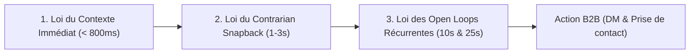

# VIRAL CONTENT ENGINE // LA BIBLE DE RÉTENTION & CONVERSION B2B
## Manuel d'Ingénierie Narrative & Algorithmique (Studio AGENT404)

> Ce document est la **référence stratégique et opérationnelle** du studio AGENT404 pour concevoir, structurer et scripter des vidéos courtes (9:16 vertical, LinkedIn, Instagram Reels, TikTok, YouTube Shorts) pour le personal branding des experts B2B sans tournage ni caméra.
> 
> Il synthétise les enseignements des **6 formats viraux d'élite** disséqués via notre pipeline `watch` et les connecte directement à nos **3 Styles de Production (Mascotte, Éditorial, Démonstration)** et à nos **9 Blueprints Universels**.

---

### SOMMAIRE
1. [Section I : Les 3 Lois Physiques de la Rétention Verticale](#section-i--les-3-lois-physiques-de-la-r%C3%A9tention-verticale)
2. [Section II : Décodage Anatomique des 6 Formats d'Élite](#section-ii--d%C3%A9codage-anatomique-des-6-formats-d%C3%A9lite)
3. [Section III : Le Générateur de Scripts en 8 Nœuds (Template Universel)](#section-iii--le-g%C3%A9n%C3%A9rateur-de-scripts-en-8-n%C5%93uds-template-universel)
4. [Section IV : Matrice de Correspondance Formats, 3 Styles et 9 Blueprints Universels](#section-iv--matrice-de-correspondance-formats-3-styles-et-9-blueprints-universels)
5. [Section V : Guide d'Application aux 2 Cibles Prioritaires et 3 Styles](#section-v--guide-dapplication-aux-2-cibles-prioritaires-et-3-styles)
6. [Section VI : Grille d'Évaluation & Checklist d'Audit Viral (Score /100)](#section-vi--grille-d%C3%A9valuation--checklist-daudit-viral-score-100)

---

### Section I : Les 3 Lois Physiques de la Rétention Verticale

Toute vidéo courte en flux mobile (LinkedIn, Instagram Reels, TikTok, Shorts) est soumise à une friction cognitive forte : **l'utilisateur peut faire défiler l'écran en moins de 400 millisecondes**. Trois lois régissent l'attention :



#### 1. Loi du Contexte Immédiat ($< 800\text{ ms}$)
* **Constat (Kallaway)** : Les spectateurs ne regardent que ce dans quoi ils ont un intérêt direct et immédiat. Reporter le contexte à la deuxième moitié de la première phrase fait chuter le taux de maintien de plus de 50 %.
* **Règle d'or** : Le sujet et la cible doivent être articulés **en audio, en texte central et en visuel simultanément dès la première seconde**.
* **Interdiction formelle** : Les ouvertures molles de type *"Salut tout le monde, aujourd'hui je voulais vous parler de..."* sont interdites.

#### 2. Loi du Contrarian Snapback (La Rupture Cognitive)
* **Mécanique** :
  1. *L'inclinaison (The Lean)* : Énoncer une croyance ou douleur familière du prospect B2B (*"Tu publies quatre posts écrits par semaine sur LinkedIn..."*).
  2. *Le Snapback* : Montrer l'angle mort immédiat (*"...mais tes meilleures explications restent bloquées dans des pavés de texte que tes prospects survolent sur mobile."*).

#### 3. Loi des Open Loops Récurrentes (Anti-Décrochage à 10s et 25s)
* **Effet Zeigarnik** : Le cerveau humain souhaite connaître la résolution d'une question ouverte.
* **Mécanique** : Dès qu'une première idée est posée ($t=8\text{s}$), ouvrir la suite logique du raisonnement avant que l'attention ne retombe, puis relancer à mi-parcours ($t=20\text{s}$).

---

### Section II : Décodage Anatomique des 6 Formats d'Élite

Nos analyses détaillées dans [references/CATALOGUE_FORMATS.md](../references/CATALOGUE_FORMATS.md) ont extrait l'ADN de 6 structures narratives :

| Réf | Créateur | Concept & Promesse | Durée | Cadence Cuts | Blueprint Clé | Style AGENT404 Associé |
| :---: | :--- | :--- | :---: | :---: | :--- | :--- |
| **01** | **Jun Yuh** | *Choosing the niche vs Becoming the niche* | 60.3s | 1 cut / 1.28s | `bp_split_timeline` | Éditorial / Mascotte |
| **02** | **Mindura** | *Génération de textes animés via terminal* | 87.7s | 1 cut / 2.10s | `bp_code_window` | Démonstration |
| **03** | **Sky Tan** | *The Ultimate Storytelling Caption Structure* | 55.9s | 1 cut / 1.80s | `bp_stat_shock` + `bp_cta_conversion` | Éditorial |
| **04** | **ContentMap**| *20 Formats de Reels (Le Listicle)* | 17.4s | 1 cut / 0.80s | `bp_grid_2x2` | Éditorial / Mascotte |
| **05** | **Kallaway** | *The Triple Hook Method* | 134.2s| 1 cut / 5.36s | `bp_hook_question` | Mascotte / Éditorial |
| **06** | **Peter Visuals**| *Formula for Viral Content (8-Node Loop)* | 23.5s | 1 cut / 0.98s | `bp_grid_2x2` + Caméra | Démonstration / Éditorial |

---

#### 1. Format Jun Yuh : Le Split-Screen Temporel (`01_jun_yuh_split_screen`)
* **Visualisation** : Écran divisé en 2 colonnes égales (Gauche : méthode classique / Droite : méthode structurée) chapeauté par une pilule temporelle (`top-milestone-bar`).
* **Progression temporelle** : `JOUR 1` $\rightarrow$ `MOIS 1` $\rightarrow$ `MOIS 3` $\rightarrow$ `MOIS 6` $\rightarrow$ `1 AN`.

#### 2. Format Mindura : L'Autopsie & Démonstration Terminal (`02_mindura_claude_code`)
* **Visualisation** : Fenêtre Néo-Brutaliste (`bp_code_window`) avec lignes de code, étapes de système ou logs qui s'affichent au rythme de la voix.
* **Intérêt B2B** : Idéal pour le style **Démonstration** (agences d'automatisation Make/n8n, développement web, CRM).

#### 3. Format Sky Tan : Le Double Entonnoir (`03_sky_tan_storytelling_caption`)
* **Visualisation** : Chiffres clés (`bp_stat_shock`) et présentation claire de l'appel à l'action (`bp_cta_conversion`).

#### 4. Format ContentMap : Le Catalogue Structuré (`04_contentmap_listicle`)
* **Visualisation** : Présentation cadencée de 4 piliers ou méthodes sous forme de tuiles (`bp_grid_2x2`).

#### 5. Format Kallaway : La Triple Hook Method (`05_kallaway_triple_hook`)
* **Visualisation** : Titre fort en haut, Avatar sticker en bas (en mode **Mascotte**), et 3 cartouches d'étapes dont la dernière se dévoile progressivement.

#### 6. Format Peter Visuals : La Boucle en 8 Nœuds (`06_peter_visuals_retention_loop`)
* **Visualisation** : Carte centrale structurée avec mouvements de caméra fluides (`easeInOutCubic`) sur chaque étape du raisonnement.

---

### Section III : Le Générateur de Scripts en 8 Nœuds (Template Universel)

Ce canevas permet de transformer un post LinkedIn ou une note vocale de 2 minutes en un script B2B de **45 à 60 secondes** :

```
[00:00 - 00:04] NŒUD 1 : HOOK (Problème précis de la cible < 800ms)
↳ « Pourquoi la plupart des refontes CRM échouent dans les six premiers mois ? »

[00:04 - 00:09] NŒUD 2 : CONSTAT (L'erreur fréquente)
↳ « Dans 80 % des PME, le problème ne vient pas de l'outil choisi, mais des saisies manuelles conservées entre les équipes. »

[00:09 - 00:18] NŒUD 3 : ÉTAPE 1 (Le diagnostic concret)
↳ « Première friction : les commerciaux continuent de remplir un fichier Excel parallèle faute d'automatisation à la source. »

[00:18 - 00:23] NŒUD 4 : RELANCE NARRATIVE (Open Loop #1)
↳ « Pour corriger cela chez notre dernier client, nous avons supprimé trois étapes manuelles. »

[00:23 - 00:35] NŒUD 5 : ÉTAPE 2 (La démonstration de la méthode)
↳ « Dès qu'un formulaire est soumis, le système enrichit la fiche, crée l'opportunité et notifie le bon consultant en moins d'une seconde. »

[00:35 - 00:42] NŒUD 6 : POINT DE VIGILANCE (Snapback)
↳ « Mais l'automatisation ne sert à rien sans une règle stricte de validation des données entrantes. »

[00:42 - 00:52] NŒUD 7 : RÉSULTAT VÉRIFIABLE (La preuve)
↳ « Résultat : douze heures de saisie économisées chaque semaine et un suivi commercial enfin fiable. »

[00:52 - 01:00] NŒUD 8 : CTA (L'invitation à l'échange)
↳ « Si vous voulez voir comment adapter cette architecture à votre équipe, écrivez-moi en message privé. »
```

---

### Section IV : Matrice de Correspondance Formats, 3 Styles et 9 Blueprints Universels

Chaque intention narrative dispose d'un blueprint technique natif dans `video.js` :

| Intention Stratégique | Style Principal | Blueprint Dédié | Paramètres Types (`scene.params`) |
| :--- | :--- | :--- | :--- |
| **Accroche & Question Choc** | Mascotte / Éditorial | `bp_hook_question` | `top_badge`, `title`, `subtitle`, `stamp_text` |
| **Duel d'Évolution Temporelle** | Éditorial / Démonstration | `bp_split_timeline` | `milestone_label`, `progress_percent`, `left_col`, `right_col` |
| **Empilement de Frictions** | Éditorial / Démonstration | `bp_friction_stack` | `header_badge`, `items` (3 frictions avec badges et offsets) |
| **Preuve Technique & Système** | Démonstration | `bp_code_window` | `window_title`, `theme`, `mode: "code"`, `lines`, `footer_stamp` |
| **Chiffre d'Autorité / Résultat** | Éditorial / Démonstration | `bp_stat_shock` | `top_badge`, `stat_from`, `stat_to`, `stat_suffix`, `progress_bar` |
| **Duel Avant / Après** | Démonstration / Éditorial | `bp_versus_compare` | `layout`, `left_or_top`, `right_or_bottom`, `footer_stamp` |
| **Méthode en 4 Piliers** | Mascotte / Éditorial | `bp_grid_2x2` | `top_badge`, `cards` (4 tuiles), `bottom_meter` |
| **Diffusion Multi-Canaux** | Mascotte / Éditorial | `bp_logo_carousel_rtl`| `top_badge`, `items` (LinkedIn, Reels, TikTok, Shorts) |
| **Appel à l'Action Final** | Tous les styles | `bp_cta_conversion` | `variant: "two_door"`, `keyword`, `button_label`, `doors` |

---

### Section V : Guide d'Application aux 2 Cibles Prioritaires et 3 Styles

Les vidéos produites pour nos clients respectent leur personnalité (leurs idées, leurs expressions, leurs couleurs, leurs réalisations et leur voix réelle lorsque c'est possible) à travers nos **3 styles de production** :

#### 1. Style Mascotte (Pédagogique, dynamique et accessible)
* **Idéal pour** : Consultants B2B et fondateurs d'agences modernes qui souhaitent une signature visuelle incarnée sans se filmer.
* **Mise en œuvre** : Utilisation modérée de l'avatar sticker illustré (`duo_lymphe` ou `solo`) sur les scènes d'accroche, de transition et de conclusion, combiné aux cartes néo-brutalistes.

#### 2. Style Éditorial (Personal branding sobre, expertise et autorité)
* **Idéal pour** : Consultants B2B haut de gamme (finance, cybersécurité, gouvernance, stratégie) et dirigeants qui préfèrent un rendu 100 % typographique et graphique sans personnage dessiné.
* **Mise en œuvre** : `avatar_mode: "hidden"` sur l'ensemble des scènes. Mise en avant des thèses, chiffres clés (`bp_stat_shock`), grilles méthodologiques (`bp_grid_2x2`) et comparatifs (`bp_versus_compare`).

#### 3. Style Démonstration (Workflows, logiciels, systèmes et études de cas)
* **Idéal pour** : Fondateurs de petites agences B2B techniques (automatisation Make/n8n, Webflow, développement web, intégration CRM).
* **Mise en œuvre** : Focus sur la visualisation concrète du problème initial, du système construit (`bp_code_window`, `bp_friction_stack`) et du résultat Avant/Après (`bp_versus_compare`, `bp_split_timeline`).

---

### Section VI : Grille d'Évaluation & Checklist d'Audit Viral (Score /100)

Avant d'autoriser le rendu final `render.py`, chaque vidéo doit être auditée et atteindre au moins **90/100 points** :

| Axe d'Audit | Critère Bloquant | Barème | Validé |
| :--- | :--- | :---: | :---: |
| **1. Hook Contexte** | Sujet et cible nommés explicitement en moins de 800ms (audio + texte) | 15 pts | [ ] |
| **2. Contrarian Snapback** | Présence d'une rupture d'attente claire dans les 3 premières secondes | 10 pts | [ ] |
| **3. Open Loop #1** | Relance narrative explicite à $t \approx 10-15\text{s}$ avant toute baisse de rythme | 10 pts | [ ] |
| **4. Open Loop #2** | Seconde relance narrative à $t \approx 25-35\text{s}$ | 10 pts | [ ] |
| **5. Rythme des Plans** | Aucun plan inerte $\ge 2.5\text{s}$ (cadence moyenne $\le 1.8\text{s}$ par événement) | 15 pts | [ ] |
| **6. Zéro Jargon Banni** | Aucun terme banni (Python, FFmpeg, Whisper, JavaScript) dans les voix | 10 pts | [ ] |
| **7. Zéro Chiffre Tarifaire**| Aucun prix (150 €, 200 €, 450 €, 750 €) prononcé ou affiché publiquement | 10 pts | [ ] |
| **8. Safe Zones 9:16** | Sous-titres dans la zone haute, marges respectées ($380\text{px}$ bas, $130\text{px}$ droite) | 10 pts | [ ] |
| **9. CTA Cohérent** | Un seul appel à l'action clair en fin de vidéo | 10 pts | [ ] |
| **SCORE TOTAL** | **Seuil minimum de publication : 90/100** | **/100** | [ ] |
