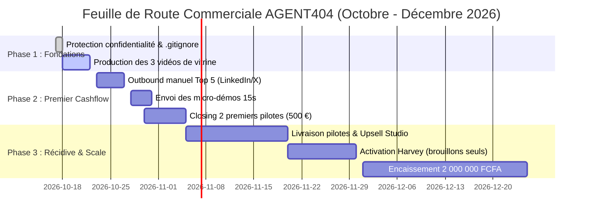

# AGENT404 · PLAN D'ACTION COMMERCIAL & TRAJECTOIRE FINANCIÈRE
**Objectif directeur :** Encaisser **2 000 000 FCFA** (~3 049 €) avant le **31 décembre 2026**.  
**Date d'élaboration :** 17 octobre 2026 (75 jours restants avant l'échéance).  
**Principes directeurs :** Pas de démarchage de masse, pas d'automatisation non maîtrisée, focalisation sur la preuve visuelle et la conversion d'équipes agiles.

---

## 1. Modélisation de l'Objectif Financier (2 000 000 FCFA)

Pour atteindre 3 049 € de cashflow net encaissé d'ici fin décembre 2026, trois combinaisons réalistes existent :

| Scénario | Offres combinées | Cashflow total encaissé | Nombre de clients requis |
| :--- | :--- | :---: | :---: |
| **Scénario A (Hybride Pilote + Studio)** | 4 Pilotes de test (4 × 250 € = 1 000 €) + 4 Abonnements mensuels Studio (4 × 500 € = 2 000 €) | **3 000 €** *(~1 968 000 FCFA)* | 4 clients convertis du pilote à l'abonnement |
| **Scénario B (Studio récurrent accéléré)** | 2 Clients Studio sur 2 mois (2 × 500 € × 2 mois = 2 000 €) + 2 Pilotes (2 × 250 € = 500 €) + 1 Déploiement moteur (1 × 750 €) | **3 250 €** *(~2 131 000 FCFA)* | 4 à 5 clients |
| **Scénario C (Cashflow Déploiement)** | 2 Déploiements Engine (2 × 750 € = 1 500 €) + 3 Abonnements Studio (3 × 500 € = 1 500 €) | **3 000 €** *(~1 968 000 FCFA)* | 3 à 5 clients |

> [!IMPORTANT]
> **Le premier pas critique :**  
> Encaisser les **500 premiers euros (328 000 FCFA)** avant le 31 octobre 2026 grâce à la signature de **2 packs pilotes à 250 €** (ex. Typebot, Piloterr ou Breakcold).

---

## 2. Feuille de Route Opérationnelle par Phase (75 Jours)

---

### Étape 1 · Sécurisation & Confidentialité (Aujourd'hui — 17 octobre)
- [ ] Valider la modification du fichier `.gitignore` pour protéger les données de prospection (`output/prospects_batch_*/`).
- [ ] Désindexer les fichiers sensibles du suivi Git (`git rm -r --cached output/prospects_batch_01`) sans toucher aux fichiers locaux.
- [ ] Confirmer que seuls le moteur, les documentations publiques et les configurations d'exemple restent exposés sur GitHub.

---

### Étape 2 · Production de la Vitrine Commerciale (18 au 22 octobre)
*Ne contacter aucun prospect sans avoir un lien vidéo MP4 parfait à montrer en réponse.*
- [ ] Exécuter `tests/test_video01_golden_master.py` pour valider l'intégrité du moteur.
- [ ] Compiler la **Démo 1 (SaaS & DevTool)** : Cas Piloterr/Typebot (Terminal cURL → JSON → Cartes enrichies).
- [ ] Compiler la **Démo 2 (Concept Technique)** : Cas Architecture d'agents IA (Double bloc flux continu).
- [ ] Compiler la **Démo 3 (Corporate Sobre)** : Cas Dashboard & gain de temps TPE (Ardoise épurée, zéro néon).
- [ ] Héberger les 3 vidéos sur un espace de visionnage direct fluide et sans publicité (ex. lien Cloudflare R2, Google Drive ou post LinkedIn public de vitrine).

---

### Étape 3 · Les 5 Premiers Contacts Manuels Ultra-Ciblés (23 au 27 octobre)

Contacter manuellement les **5 premiers profils du Top 10** en utilisant exclusivement les messages révisés de `messages_revised.md` :

1. **Baptiste Arnaud (Typebot) :**
   - Canal : Message Twitter (`@baptisteArno`) ou GitHub.
   - Accroche : Proposition d'une micro-démo de 15s sur son dernier bloc Blink.
2. **Josselin Liebe (Piloterr) :**
   - Canal : Message Twitter (`@josselinlbe`) ou LinkedIn.
   - Accroche : Montrer l'extraction d'un endpoint LinkedIn en direct plutôt que du JSON brut.
3. **Arnaud Belinga (Breakcold) :**
   - Canal : Message Twitter (`@ArnaudBelingaCX`) ou LinkedIn.
   - Accroche : Animer l'interaction feed social vers CRM en 15 secondes.
4. **Bruno Laporte (Pharow) :**
   - Canal : Message privé LinkedIn.
   - Accroche : Remplacer un carrousel PDF de 8 slides par une vidéo de 20s de recherche multi-filtres.
5. **Amaury de Luca (Noqode) :**
   - Canal : Message LinkedIn ou email direct.
   - Accroche : Mettre en valeur au scroll ses récentes réalisations de sites Webflow.

---

### Étape 4 · Gestion des Réponses & Closing du Pilote (28 octobre au 5 novembre)
- **Règle de réponse :** Dès qu'un prospect répond *"Oui, montrez-moi"* ou exprime de la curiosité :
  - Envoyer sous 2 heures un extrait vidéo de 15 secondes personnalisé avec son logo et ses couleurs.
  - Formuler la proposition : *"Nous pouvons vous livrer un pack de 3 vidéos de ce calibre pour 250 € HT livrées sous 48h. Si le résultat ne vous convient pas, vous ne payez rien."*
- **Encaissement sécurisé :** Acompte de 50 % ou paiement par Stripe / virement avant livraison des masters.

---

### Étape 5 · Montée en Charge & Rétention (Novembre à Décembre)
- Livrer les vidéos des pilotes avec un niveau de finition irréprochable.
- À la livraison, proposer la conversion vers l'abonnement mensuel : *"Pour maintenir ce rythme de 2 vidéos par semaine sur vos réseaux, notre formule Studio est à 500 €/mois pour 8 vidéos."*
- Si 2 clients pilotes s'abonnent en récurrent : **1 000 €/mois de MRR récurrent sécurisé** (soit 655 000 FCFA/mois).
- Compléter par 1 ou 2 déploiements du moteur chez des agences (Florian Bodelot chez Digidop) à 750 € pour encaisser le solde nécessaire avant le 31 décembre 2026.

---

## 3. Matrice des Risques et Parades d'Exécution

| Risque identifié | Probabilité | Impact | Parade opérationnelle immédiate |
| :--- | :---: | :---: | :--- |
| **Absence de réponse sur les 5 premiers messages** | Moyenne | Moyen | Relance unique à J+4 avec une variante d'angle. Si silence, basculer sur les prospects 6 à 10 du Top 10 (Tally, Digidop, Missive, Crisp, Contournement). |
| **Objection "Je n'ai pas le budget"** | Faible | Faible | Proposer un test unitaire à 99 € sur une seule vidéo pour créer le premier lien commercial. |
| **Tentative d'automatiser trop tôt avec Harvey** | Élevée | Élevé | Verrouillage strict : pas d'utilisation d'Harvey tant que les 3 premiers clients manuels ne sont pas encaissés. |
| **Dérive vers de nouvelles fonctionnalités dans le moteur** | Moyenne | Élevé | Règle absolue : moratoire total sur le code du moteur jusqu'au premier encaissement réel. |
